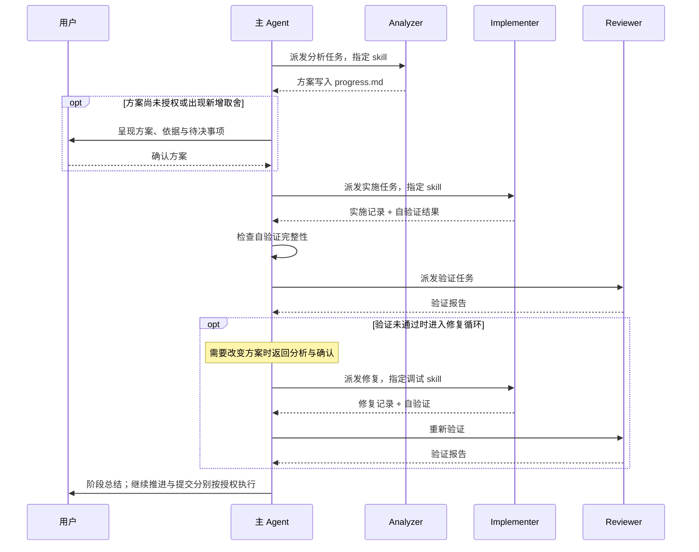

# NPU 模型基础优化 Agent Skills 设计文档

> 本文档覆盖基础优化工作流及通用开发规范；进阶性能调优见 [SOTA 工作流设计](sota-approach-skill-design.md)。

## 1. 项目概述

### 1.1 项目定位

本项目是 [cann-recipes-infer](https://gitcode.com/cann/cann-recipes-infer) 仓库的 Agent Skill 框架，基于 CANN 平台能力和仓库已有模型的优化经验，将 NPU 推理工作中的关键判断、阶段依赖和验证流程模块化，由专业 Agent 协同推进。基础优化工作流由 `model-infer-optimize` 编排 migrator → 并行 → KVCache → 融合 → 量化 → 图模式 → 总结；进阶性能调优工作流由 `model-infer-sota-approach` 在已有 baseline 之上探索优化方向与组合。

### 1.2 核心目标

- 将分散的 NPU 推理优化知识总结组织为可按需加载的 Skill
- 通过阶段化编排和验证驱动，降低优化路径走偏的风险
- 沉淀仓库模型的优化经验为可复用的参考链路
- 建立昇腾社区 NPU 推理优化的 Skill 能力
- 促进 Skill 的协同开发、共享和创新

### 1.3 目标用户

- 使用昇腾 NPU 进行模型推理优化的开发者
- 需要 Agent 辅助完成 NPU 推理适配的团队

## 2. 项目架构设计

### 2.1 整体结构

```
cann-recipes-infer/
├── AGENTS.md              # 项目根指令
├── docs/agent/            # Agent 体系设计文档
├── scripts/init-agent.sh  # 初始化脚本
└── .agents/               # Skills / SubAgents / Hooks 源目录
    ├── README.md          # Skill 体系总览
    ├── agents/            # SubAgent 定义（3 个）
    ├── hooks/             # Hook 检查脚本
    ├── settings.json      # 客户端 Hook 注册配置
    └── skills/            # Skill 定义（详见 2.3 Skill 分类）
```

使用前按[安装说明](../../.agents/README.md#安装)运行 `scripts/init-agent.sh`，安装知识库查询技能并生成客户端视图。

### 2.2 Skill 调度架构

框架采用 **Agent Team** 模式——由一个编排 Agent 协调多个专业 Agent 协作完成复杂任务。每个 Agent 加载不同的 Skill，各自专注于特定阶段的工作，通过共享状态文件协同推进。该模式是框架层能力，不绑定单一工作流；基础优化工作流以 `model-infer-optimize` 作为编排入口，具体实现为"主 Agent + SubAgent"的调度方式：

- **主 Agent**：加载工作流编排 Skill，负责全局编排、阶段推进和进度管理
- **SubAgent**：由主 Agent 按需启动，加载特定阶段的 Skill 执行具体任务，完成后将结果返回主 Agent

调度流程如下：

```
用户任务
  │
  ▼
主 Agent（加载 model-infer-optimize）
  │
  ├── 阶段 0：模型分析与基线建立
  │   ├── analyzer ──→ 架构分析、环境确认
  │   ├── implementer ──→ model-infer-migrator（框架适配、基线采集）
  │   ├── reviewer ──→ 新增或修复的部署代码与基线验收
  │   └── analyzer ──→ model-infer-quantization（用户启用且产物已交付时初评估）
  │
  ├── 阶段 1：并行化改造（多卡部署时）
  │   ├── analyzer ──→ model-infer-parallel-analysis（策略推荐）
  │   ├── implementer ──→ model-infer-parallel-impl（代码改造）
  │   └── reviewer ──→ 验证并行正确性
  │
  ├── 阶段 2：KVCache + FA
  │   ├── analyzer ──→ model-infer-kvcache（方案分析）
  │   ├── implementer ──→ model-infer-kvcache（实施改造）
  │   └── reviewer ──→ 精度/性能验证
  │       └── FAIL → implementer ──→ model-infer-precision-debug（精度排查）
  │
  ├── 阶段 3：融合算子
  │   ├── analyzer ──→ model-infer-fusion（模式匹配）
  │   ├── implementer ──→ model-infer-fusion（算子替换）
  │   └── reviewer ──→ 精度/性能验证
  │
  ├── 阶段 4：量化适配改造（如阶段 0 完成量化初评估且用户启用）
  │   ├── analyzer ──→ model-infer-quantization（实施前变更复核）
  │   ├── implementer ──→ model-infer-quantization（量化接入）
  │   └── reviewer ──→ 精度/性能验证
  │
  ├── 阶段 5：图模式适配
  │   ├── analyzer ──→ model-infer-graph-mode（方案设计）
  │   ├── implementer ──→ model-infer-graph-mode（适配实施）
  │   └── reviewer ──→ 精度/性能验证
  │
  └── 阶段 6：优化总结 ──→ 输出优化报告
```

已完成或不适用的阶段记录依据后跳过，有效结果可复用。模型需多卡才能运行时，先完成适配准备，在阶段 1 运行与精度验收后建立首个基线。精度或运行时问题按需使用 `model-infer-precision-debug`、`model-infer-runtime-debug`。

设计考虑：

- **隔离上下文**：每个 SubAgent 只加载对应阶段的 Skill 和 references，避免上下文窗口被无关信息占满
- **阶段间状态传递**：通过 `progress.md` 共享文件传递阶段间的设计决策和验证结果，支持断点接力
- **验证卡点**：主 Agent 在每个阶段之间做验证判断，决定是否进入下一阶段

### 2.3 Skill 分类

| 类别 | Skill | 说明 |
|------|-------|------|
| 编排 | model-infer-optimize | 基础优化工作流编排入口，阶段 0-6 |
| 编排 | model-infer-sota-approach | 已有 baseline 之上的进阶性能调优 |
| 基础优化工作流 | model-infer-migrator | 框架适配与基线建立 |
| 基础优化工作流 | model-infer-parallel-analysis | 并行策略分析 |
| 基础优化工作流 | model-infer-parallel-impl | 并行切分实施 |
| 基础优化工作流 | model-infer-kvcache | KVCache + FA 替换 |
| 基础优化工作流 | model-infer-fusion | 融合算子替换 |
| 基础优化工作流 | model-infer-quantization | 量化适配改造（可选） |
| 基础优化工作流 | model-infer-graph-mode | 图模式适配 |
| 调试 | model-infer-precision-debug | 推理精度定界、对比、定位与根因确认 |
| 调试 | model-infer-runtime-debug | NPU 运行时错误诊断 |
| 性能分析 | model-infer-profiling | 性能数据采集 |
| 性能分析 | model-infer-perf-breakdown | 性能数据拆解与优化线索 |
| 独立进阶优化 | model-infer-multi-stream | 多流并行 |
| 独立进阶优化 | model-infer-prefetch | 权重预取 |

## 3. Agent 角色设计

### 3.1 角色分工

通过分析/实施/验证的职责隔离，降低单个 Agent 同时承担多角色导致的越界与漏检问题：

| 角色 | 职责 | 修改边界 |
|------|------|----------|
| 主 Agent | 阶段编排、用户确认、进度管理与验收裁决 | 维护状态与报告，模型改造交 implementer |
| analyzer | 架构分析、方案设计 | 只读模型代码与配置，写分析产物 |
| implementer | 按确认方案改造代码、调试修复与自验证 | 本轮实施范围内的代码、配置及产物 |
| reviewer | 独立验证精度、性能与仓库规范 | 可准备测试文件与诊断，模型修复及回退交 implementer |

三个角色共享核心原则：禁止编造解释，遇到异常数据必须先用工具调查。

角色也可独立调用：按任务指定的 skill 执行相关部分，未指定时选用适用的 skill；优先读取本任务的 `progress.md`，按调用方要求交付。

### 3.2 协作信息流



每阶段遵循统一流程：

1. 主 Agent 派发 analyzer 进行方案分析，结果写入 progress.md
2. 主 Agent 呈现方案与依据，沿用已有授权；新增取舍或方案变更由用户确认
3. 确认后派发 implementer 实施改造，implementer 必须完成自验证
4. 主 Agent 核对代码加载、适用的编译检查、推理与输出证据，缺失或矛盾时交 implementer 调查补齐
5. 派发 reviewer 进行精度和性能验证
6. 验证未通过时，派发 implementer 修复 → reviewer 重新验证；改变方案时返回分析与确认，修复受阻时按证据和授权决定继续、回退或停止
7. 验收后输出阶段总结，更新当前状态；继续推进与提交分别按用户决定或已有明确授权执行

### 3.3 派发规范

主 Agent 的 dispatch prompt 给出本轮任务范围、工作目录、progress.md 路径、所用 skill 和输入产物位置，按需补充影响执行的上下文。SubAgent 读取共享状态，按任务范围使用 skill 的分析、实施或验证部分，待决事项返回主 Agent。

## 4. 状态管理设计

### 4.1 共享状态文件

SubAgent 之间通过 `progress.md` 共享阶段结论和任务状态，实现跨 Agent、跨阶段、跨会话的上下文接力：

```
{model_dir}/agentic/
├── progress.md              ← 活跃文件，所有 SubAgent 启动时读取
│   ├── 常驻区：模型信息、当前方案、原始基线与前一有效版本
│   │   └── 进度概览表，主 Agent 随阶段推进更新
│   ├── 分隔标记
│   └── 工作区：当前阶段记录，阶段推进时归档清空
│
├── progress_history.md      ← 历史归档，按需索引
│
└── baseline/
    └── baseline_metadata.json ← 性能基线，reviewer 验证基准
```

### 4.2 读写规则

- **常驻区**由阶段 0 的 analyzer 初始化，主 Agent 维护当前方案、基线引用与进度概览，保留原始基线
- **工作区**由各 SubAgent 追加，写入前先读取现有内容
- **阶段推进**：验收或回退、跳过的决定收口后，主 Agent 更新常驻结论，再用归档脚本将工作区转入 `progress_history.md` 并清空；阶段 0 不归档
- **历史归档**按需定位与读取，总结时汇总所需记录

## 5. Skill 标准化设计

### 5.1 遵循标准

本项目遵循 [Agent Skills 规范](https://agentskills.io/home)，Skill 可被支持该规范的客户端识别和加载。

### 5.2 Skill 目录结构

Skill 的专用模板、流程参考和工具集中在自身目录；共享资源通过明确路径引用，技术知识按第 6 节查询：

```
skill-name/
├── SKILL.md              # 技能定义文件（必需）
├── references/           # 参考文档（可选）
│   ├── domain-doc-1.md   #   必要流程、接口契约、代码样例等
│   └── domain-doc-2.md
├── templates/            # 模板文件（可选）
│   └── report-template.md
└── scripts/              # 辅助脚本（可选）
    └── utils.py          #   调试工具、验证脚本等
```

| 目录/文件 | 必需 | 说明 |
|-----------|------|------|
| `SKILL.md` | 是 | 技能定义，包含 frontmatter 和工作流程 |
| `references/` | 否 | 必要流程、接口契约与样例，供 Agent 按需读取 |
| `templates/` | 否 | 报告模板、代码模板等 |
| `scripts/` | 否 | 辅助工具脚本（调试、验证等） |

### 5.3 SKILL.md 规范

frontmatter 必需字段：

```yaml
---
name: skill-name          # kebab-case，与文件夹名一致
description: 单行描述      # 触发场景关键词，< 1024 字符
---
```

### 5.4 命名规范

- `SKILL.md` 文件名严格区分大小写
- Skill 文件夹使用 kebab-case（如 `model-infer-kvcache`）
- Skill 文件夹内不放 `README.md`，文档内容在 `SKILL.md` 或 `references/` 中

## 6. 知识组织设计

### 6.1 分层上下文

按任务需要加载指引与知识：

| 位置 | 内容 | 加载时机 |
|------|------|----------|
| AGENTS.md | 项目入口、Skill 路由、通用约束与知识库入口 | 客户端加载项目指令时 |
| SKILL.md | 任务范围、关键判断、执行与交付要求 | 匹配或指定技能时 |
| references/、templates/ | 必要流程、接口契约、代码样例与完整模板 | 当前步骤需要时 |
| cannbot-knowledge | 部署样例、版本资料、优化与排障经验 | 按问题查询 |

编排 skill 管理方案确认、派发和验收；技术 skill 按任务范围提供分析与实施指导，框架约束注明适用范围。

### 6.2 知识查询与来源

部署样例、接口与版本资料、细节排障经验通过 `knowledge-query` 查询 cannbot-knowledge，按目标框架、平台、版本及适用条件采用；需要官方资料时追踪对应来源。Skill 在决策点简短说明查什么，查询方法和知识根定位遵循 `knowledge-query`。已验证经验的回流入口见 [AGENTS.md](../../AGENTS.md#知识库)。

### 6.3 references 设计说明

references 保留支撑任务判断与执行的必要内容，包括接口契约、完整模板、仓库推荐写法和关键经验权衡；具体模型部署过程、版本索引和细节排障案例优先查询知识库。模板中的约束和重要判断可与知识库双份保留，避免检索结果不完整时丢失执行依据。

## 7. 验证设计

### 7.1 Skill 有效性验证

采用"有 Skill / 无 Skill"对比测试方法：

- 相同模型、相同基线、相同硬件、相同 Agent 能力
- 唯一变量：是否加载 Skill
- 对比维度：正确性、最终性能、任务完成度与执行成本

### 7.2 每阶段验证机制

每个实施阶段按已确认的验收口径验证：

- **精度验证**：按已确认参照与达标线检查，如 Prefill logits cosine similarity、Decode token match
- **性能验证**：按目标负载同口径实测，分别记录相对前一有效版本的增量和原始基线的累计变化；部署规模或负载变化时单列条件

未通过精度验证时，触发精度调试 Skill 进行排查。

## 8. Harness 与约束机制

### 8.1 设计思路

Skill 和 Agent 定义明确任务边界、关键判断与验收依据；Hook 对可机械检查的角色修改边界和记录完整性提供辅助检查，主 Agent 负责核查真实证据与推进决策。

### 8.2 约束分类

| 类型 | 机制 | 示例 |
|------|------|------|
| 角色边界 | Agent 定义与派发任务范围 | analyzer 只读模型代码；reviewer 可准备测试文件，模型修复交 implementer |
| 流程规则 | Skill 中的阶段前置条件和验证门禁 | 实施改动经精度、性能验收后进入下一适用阶段 |
| Hook 检查 | 配置覆盖的工具事件触发脚本 | 角色修改边界、自验证记录完整性检查 |

### 8.3 Hook 机制

Hook 脚本位于 `.agents/hooks/`，接入后按匹配的角色和工具事件执行；客户端支持范围见[安装说明](../../.agents/README.md#安装)：

| Hook | 触发时机 | 作用 |
|------|---------|------|
| 角色修改边界 | 文件编辑前 | 按角色保护规则拦截对命中文件的修改 |
| progress 路径关联 | 文件读取或修改成功后 | 记录当前 subagent 使用的 progress.md 路径，供自验证检查定位 |
| 自验证记录检查 | implementer 结束时 | 已关联 progress.md 时，检查本轮自验证字段是否齐全 |
| 长任务提醒 | 文件编辑或命令执行前 | 超 60 分钟后周期提醒核对方案、进展与阻塞，不阻断任务 |

## 9. 演进规划

### 9.1 演进方向

- **场景与框架扩展**：验证更多模型、硬件与部署框架，复用技术 skill 并明确框架约束
- **性能调优能力完善**：基于 profiling 与性能拆解探索优化组合；SuperKernel 复用外部工作流，入口见 [AGENTS.md](../../AGENTS.md#skill-路由)
- **知识积累**：将已验证、可复用的工程经验按知识库规范沉淀，结合实际任务反馈改进 Skill
- **新方案设计能力拓展**：新增融合算子设计与开发能力、量化方案及实现；软硬件协同优化迭代

### 9.2 演进原则

- 每个新 Skill 独立开发、独立验证，不影响已有 Skill
- 技术 Skill 按任务与依赖接入适合的工作流
- 持续通过真实模型测试积累经验，迭代 Skill 编排与 references 中的参考链路

## 10. 协作与贡献

### 10.1 贡献流程

1. 在上游仓库提交 RFC（Issue）描述技能方案
2. Fork 仓库，创建特性分支
3. 按照 Skill 标准化规范开发
4. 提交 PR 并关联 RFC Issue
5. 代码审核与合并

### 10.2 审核标准

- SKILL.md frontmatter 格式正确
- 命名规范符合 kebab-case
- 正文、references、模板与脚本一起审查，引用和接口与当前实现一致
- 保留关键判断、真实约束、仓库规范和最小充分模板；模型或版本特例注明适用条件
- 精简前判断该信息是否为任务所需，以及 Agent 能否从任务、代码与已有上下文可靠恢复；新增说明同样检查必要性
- 分析返回方案与待决事项，实施承接已确认方案，验证交付证据；固定流程顺序有技术依赖支撑
- 知识库指引就近说明查询对象；具体知识归属按第 6 节判断
