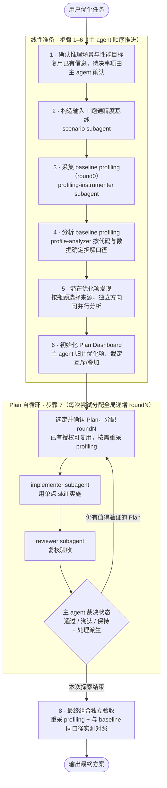
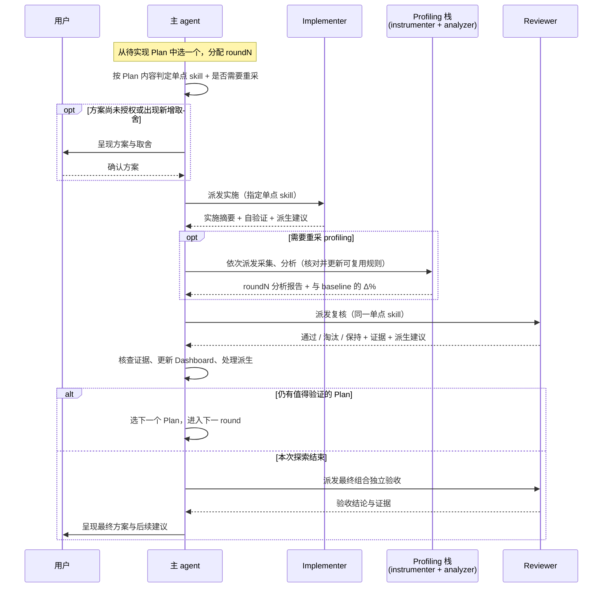

# 模型推理进阶性能调优技能设计文档（model-infer-sota-approach）

本文档描述 `model-infer-sota-approach` 这一**模型推理进阶性能调优技能**的设计。Skill 体系的通用约定（目录结构、SKILL.md 规范、命名规范、Hook 机制、贡献流程等）见 [基础优化设计文档](model-infer-optimize-design.md)，本文档聚焦本技能的编排架构、潜在优化项发现、Plan 自循环、分层状态管理与证据口径设计。

## 1. 概述与定位

### 1.1 技能定位

`model-infer-sota-approach` 在一个**已经可运行的 baseline** 之上，由 profiling 数据驱动，按瓶颈选择优化方向，独立方向可并行分析，再用 Plan 自循环（实施 → 复核 → 保留或淘汰 → 按需派生）验证收益与组合效果。

它只负责**整条编排**——从推理场景建立、精度基线、profiling 采集与分析，到潜在优化项发现、Plan 实施、review、派生和最终验收；具体的代码改造由各单点技术 skill 负责，本技能不介入。其核心特征是**不预设固定阶段**：优化方向并非预先排定的流水线，而是由 profiling 分析识别得出，再用统一的 Plan 状态机逐个验证、收敛。这使它适合在 baseline 之上进一步挖掘性能空间，以及探索标准路径之外的非标准组合优化。

### 1.2 适用场景

- 已有可运行 baseline，需在其上继续进行 profiling 驱动的深度优化；
- 优化方向不止一个、且彼此可能互斥或叠加，需要多方向分析、逐个实施验收；
- 涉及融合算子、prefetch、图模式、多流、KVCache、量化、并行等多种优化项的统一调测编排。

### 1.3 前置条件

模型必须**已完成框架适配，并已有一个可运行、可复现精度的 baseline**。如果模型尚未适配进框架、或尚无 baseline，应先完成框架适配与基线建立，再进入本技能。本技能不承担"从零适配"的工作，其起点假定为一条语义正确、精度可复现的推理路径。

### 1.4 设计目标

- **多方向发现**：按瓶颈选择候选来源，独立方向可并行分析；
- **探索可收敛**：用 Plan 自循环将"试验一个方向 → 验证 → 保留或淘汰 → 派生新方向"结构化，使探索式优化可收敛、可追溯；
- **证据驱动裁决**：按目标指标的同场景、同测量方式实测判定收益，profiling 用于瓶颈定位与收益归因；
- **状态可接力**：通过分层状态文件支持跨 agent、跨 round、跨上下文压缩的状态接力。

### 1.5 职责边界

| 边界 | 说明 |
|------|------|
| 编排与执行分工 | 主 agent 负责阶段推进、用户交互、派发、Dashboard 维护和验收裁决；采集 / 分析 / 实施 / 独立复查交 subagent |
| 不嵌套编排 | 编排职责由本技能独占，**不调用其他编排流程**；具体优化交给它调用的单点技术 skill |
| 实施 skill 按 Plan 内容定 | 用哪个单点 skill（多流 / prefetch / 融合 / 图模式 / 量化 / 并行等）由主 agent 在 Plan 实施阶段按 Plan 内容判定，作为 implementer 的领域 skill 传下去 |

## 2. 整体编排架构

### 2.1 编排流程总览

主 agent 按 8 个步骤推进：前 6 步是线性准备，第 7 步是 Plan 自循环，第 8 步是最终验收。



### 2.2 探索式编排：为何不预设固定阶段

设计考虑：基础流程按技术依赖推进适用阶段；baseline 之上的进阶调优，则需结合实测与 profiling 判断方向的收益、适用性及组合冲突。因此由瓶颈与任务范围决定尝试顺序。

因此本技能以「profiling 分析 → 多方向潜在优化项发现 → Plan 自循环」取代固定阶段：优化方向由 profiling 数据识别得出（第 4–5 步），再用统一的 Plan 状态机逐个验证、收敛（第 7 步）。固定的是编排骨架，可变的是具体执行哪些 Plan、迭代多少轮，由证据决定。

### 2.3 主 agent 独占编排 + subagent 执行

主 agent 是唯一的编排者与交互方；所有具体执行——采集、分析、潜在优化项发现、实施、复核——均派给 subagent。这样做有两个目的：

- **隔离上下文**：采集与分析的输出冗长，实施与复核涉及大量代码细节，将它们留在各自 subagent 的上下文中，主 agent 只接收结论摘要与产物路径，避免主上下文被无关信息占满；
- **角色隔离**：分析、实施、复核分属不同 subagent；reviewer 可准备测试与诊断，模型代码修复交 implementer，保留独立复查。

主 agent 派发时传入已确认的信息；subagent 执行中发现的待决事项返回主 agent 处理（详见 §3.2）。

### 2.4 性能分析栈边界

profiling 的采集与分析交给两个独立 skill，本流程只调用、不重复它们的内部契约：

| skill | 职责 | 在本流程中的角色 |
|-------|------|-----------------|
| `model-infer-profiling` | 采集 profiling 数据（`kernel_details.csv` 等） | 由 profiling-instrumenter subagent 调用 |
| `model-infer-perf-breakdown` | 拆解时间分布、异常层与算子；启用依赖外部 skill 的理论对比时，补充逐算子实测 / 理论 gap | 由 profile-analyzer subagent 调用 |

采集与分析契约由各 skill 定义；本流程核对目标指标的同口径实测与 profiling 归因证据（详见 §7）。

## 3. Subagent 角色设计

### 3.1 角色清单与职责

本技能通过派发模板定义六类任务角色，全部由主 agent 派发：

| subagent | 职责 | 主要产物 | 写权限 |
|----------|------|---------|--------|
| `scenario` | 构造可复现推理输入、跑通精度基线、记录判定口径 | `scenario.md`、输入样本 / 构造脚本、基线证据 | 场景与输入产物 |
| `profiling-instrumenter` | 为已跑通场景插入 / 启用 profiling 采集（可重复、可关闭、可回退） | 采集命令、profiling 产物目录 | 采集代码、配置与产物 |
| `profile-analyzer` | 用 perf-breakdown 分析时间分布；按需补充理论对比 | 性能分析报告 | 分析产物 |
| `candidate` | 从一个来源（§4.2 表一行）发现潜在优化项，产出 Plan 草案 | `analysis/<source>.md` | 自己的方向分析文件 |
| `implementer` | 用 Plan 指定的单点 skill 实施单个 Plan | 代码改动、`plan-<id>.md` 实施记录 | 代码 + progress.md + plan 文件 |
| `reviewer` | 独立验收当前 Plan 或最终组合，提出状态建议 | Review 记录与验证证据 | 测试、诊断产物 + progress.md + plan 文件；模型修复交 implementer |

所有 subagent 均为**非交互**：已确认信息由主 agent 随 prompt 传入，待决事项返回主 agent。每次派发前，主 agent 从 [`references/subagent-prompt-templates.md`](../../.agents/skills/model-infer-sota-approach/references/subagent-prompt-templates.md) 取对应模板、替换占位符。

### 3.2 主 agent 作为唯一交互方

用户交互由主 agent 统一处理，复用已有信息与授权：

- **场景确认**：先从任务、配置和已有记录确定场景，缺失或冲突事项再向用户确认；
- **分析口径**：profile-analyzer 根据模型实现、数据与已有规则确定拆解口径；影响结果且无法消解的疑问返回主 agent；
- **方案确认**：实施前向用户呈现方案与取舍，已有授权可复用；新增取舍或超出授权的变更由主 agent 确认后推进。

如此既保证 subagent 全程非交互、输出可控，又不遗漏必要的用户决策。

### 3.3 派发规范

主 agent 的 dispatch prompt 遵循以下规范（对所有 subagent 一致生效）：

- **配置继承主 agent**：每个 subagent 的 model、thinking、上下文强度均与主 agent 一致，不降级、不缩短推理、不更换配置；
- **只回摘要与路径**：subagent 将详细产物落盘，回传给主 agent 的仅有结论摘要、证据文件路径与需主 agent 决策的问题，不将长日志 / 完整 profile / 原始表回传至主上下文；
- **共享上下文**：dispatch 传入任务范围、产物路径与 `progress.md`，可补充影响执行的信息；共享文件记录场景、精度口径、baseline 瓶颈、已通过 Plan 与当前 round 目标；
- **Dashboard 只读**：Plan Dashboard 由主 agent 独占维护，subagent 可读取以了解全局，但不直接写入，自身产出通过回传摘要交主 agent 落库；
- **性能口径统一**：目标指标按同场景、同测量方式实测，profiling 报告用于定位瓶颈和解释收益。

设计考虑：共享上下文集中在 `progress.md`，派发 prompt 聚焦本次任务与相关路径，便于跨 agent 接力并控制上下文规模。

### 3.4 协作信息流

以第 7 步 Plan 循环的一个 round 为例，主 agent 与各 subagent 的协作时序如下：



准备阶段（第 1–6 步）的信息流与此类似：主 agent 顺序派发 scenario → profiling-instrumenter → profile-analyzer，再从 §4.2 表选择来源派发 candidate，独立方向可并行分析，最后归并并初始化 Dashboard。

## 4. 潜在优化项发现机制

### 4.1 多来源并行发现

潜在优化项发现是本技能探索的入口。主 agent 按瓶颈与任务范围选择来源，让 candidate 从各自角度发现优化项，再统一归并。每个 candidate 只负责一个来源、写入自身的产物文件，独立方向可并行执行。

### 4.2 来源注册表与可扩展性

潜在优化项的来源在 SKILL.md §5 的来源表注册，当前注册三个来源：

| 来源（source） | 方法 | 产物文件 |
|--------------------|------|---------|
| `multi-stream` | 按分析范围拆解模块 / 算子 DAG、判断并行性，提出有实质差异的编排候选 | `analysis/multi-stream.md` |
| `knowledge` | 通过 `knowledge-query` 查询 cannbot-knowledge 中同框架、平台与负载的优化样例和适用约束 | `analysis/knowledge.md` |
| `perf-insight` | 根据 baseline insight 评估融合、重复拷贝与格式转换、bubble 与抖动热点；权重读取受限且有预取窗口时评估 prefetch；启用理论对比时补充理论偏离热点 | `analysis/perf-insight.md` |

设计考虑：来源采用注册式设计，新增来源时在 SKILL.md §5 表增加一行，复用 candidate 模板。来源所需工具 / skill 不可用时跳过该行，无需改动编排骨架。

### 4.3 来源内判互斥、跨来源归并

每个 candidate 只负责一个方向，因此：

- **来源内**的互斥 / 叠加关系，由该 candidate 自行判定并写入产物文件；
- **跨来源**的互斥 / 叠加关系，单个 candidate 无法看到全貌（例如"融合算子改写 attention"与"多流切分 attention"分属两个来源，却作用于同一段计算），**必须由主 agent 在初始化 Dashboard 时统一归并、裁定**。

主 agent 在第 6 步归并重复或等价的优化项；有实质差异的编排保留为不同 Plan，同一方案的参数调整记录在其后续 round。

### 4.4 先发现、后初始化 Dashboard

设计考虑：若在潜在优化项缺乏证据支撑时即初始化 Dashboard，后续裁决将无从依据。因此本技能强制**先完成潜在优化项发现、再初始化 Dashboard**——下列信息齐备后方可初始化：

- 推理场景及精度 / 功能口径已记录在案；
- 场景已跑通（即便被阻塞，也已查清原因，且用户仍要求继续）；
- baseline 的 profiling 采集方式已建立，或已有可直接复用的数据；
- baseline profiling 已分析完毕，产出了可回查的报告；
- 至少有一个 candidate 返回了潜在优化项，或本次所选来源均已明确判定无合适候选。

用户若直接提供一份优化列表，仅作为种子分配给对应来源的 candidate，仍须经规范化后再进入 Dashboard，增删合并须说明原因。

## 5. Plan 自循环机制

Plan 自循环是本技能的核心：潜在优化项发现给出一批待验证的优化方向，Plan 循环负责将它们逐个实施、验证、保留或淘汰，并在过程中派生新方向，直至收敛。

### 5.1 Plan 状态机

全程只允许三种状态：

| 状态 | 含义 |
|------|------|
| `待实现` | 尚未实施，或证据不足但仍有继续实施、调测的价值 |
| `通过` | 有明确收益或必要价值，且功能、精度、回退路径和副作用都已检查通过 |
| `淘汰` | 不满足保留标准且已无继续调测价值，或被同一互斥组里更优的 Plan 替代 |

设计考虑：状态刻意只设三种，避免"部分完成""疑似有效"之类的模糊中间态——任一 Plan 在任意时刻都明确处于"待办 / 保留 / 丢弃"之一，使 Dashboard 成为可快速通览全局的状态真相源。证据不足但仍有价值的情形归入 `待实现`（可继续调测），而非新增状态。

### 5.2 全局递增 round

每次尝试 Plan 或调整强度时分配独立的**全局递增 `roundN`**；派生 Plan 也在开始尝试时分配，保留各轮独立记录。

设计考虑：round 是全局单调递增的时间轴，而非每个 Plan 各自的局部计数。这样任意一次尝试（包括同一 Plan 的不同强度、不同锚点）都有唯一编号，profiling 产物、Dashboard 裁决、plan 文件记录可借 roundN 一一对应，避免编号复用导致的证据错配。

### 5.3 实施 → review → 派生循环

从 `待实现` Plan 中选一个，分配 `roundN`，进入循环：

```text
选定 Plan / 分配 roundN
  → 主 agent 按 Plan 内容判断实施用哪个单点 skill
  → 主 agent 判断本轮是否需要重采 profiling（见 §7.2）
  → implementer subagent 用选定的 skill 实施当前 Plan
  →（需要时）依次派发 profiling-instrumenter、profile-analyzer，采集本轮 profiling 数据并生成分析报告
  → reviewer subagent 复核并验收 implementer 的工作
  → 主 agent 按 decision-rules 更新状态、处理派生建议
  → 根据任务范围与继续验证的价值，选择下一 round 或进入最终验收
```

- **实施 skill 由主 agent 按 Plan 内容定**，作为 implementer 的领域 skill 传下去；reviewer 用同一个 skill 复核。
- implementer **只实施当前一个 Plan**，不一并修改其他 Plan；发现更合理方案时可**建议**派生，但不得覆盖当前 Plan。
- reviewer 独立复核验收，可准备测试与诊断、建议派生；模型代码修复与回退交 implementer。

### 5.4 派生机制

设计考虑：探索中，当前 Plan 可能指向另一条更优路径。派生时保留旧 Plan 的证据与裁决历史，新 Plan 另起 `plan_id`、初始状态 `待实现`，开始尝试时分配新 `roundN`，使优化路径的演化可追溯。

implementer、reviewer 和主 agent 都可以提议派生，最终由主 agent 写入 Dashboard。常见触发：当前 Plan 核心假设被推翻但证据指向另一条可行路径、同一优化点还有未试过的编排 / 算子 / 参数变体、原方案落地成本过高但存在更小切口、reviewer 确认有收益但还有更优变体、Plan 被淘汰的原因是"这条实现路径不合适"而非"优化点无价值"、多个已通过 Plan 组合后退化需专门治理组合。派生记录要写清：派生自哪个 Plan / round、来源是 implementer / reviewer 还是 main、触发现象、新旧 Plan 的差异。

### 5.5 互斥与叠加裁定

潜在优化项来自不同来源，机制上可能互斥、也可能正交可叠加，必须由主 agent 统一裁定：

- **互斥组**：同一互斥组最终只保留一个、或一组明确兼容的 `通过` Plan；新 Plan 替代旧 Plan 时，把旧 Plan 改为 `淘汰`，原因写明"被 Plan-X 替代"；
- **可叠加**：可叠加的 Plan 可以同时通过，但**不得默认收益可线性叠加**——必须在最终验收中实测叠加后的代码路径与指标；两个单独通过的 Plan 组合后若退化，追加一个组合验证 round，必要时淘汰组合收益更差的一方。

跨方向的冲突要在初始化 Dashboard 时就识别（§4.3），单个 candidate 无法看到全貌。

### 5.6 状态裁决规则

每轮 implementer / reviewer 返回后，主 agent 按以下规则裁决（完整判据见 [`references/decision-rules.md`](../../.agents/skills/model-infer-sota-approach/references/decision-rules.md)）：

- **判 `通过`**：reviewer 独立验证通过，有争议时核查证据并安排复验；该 Plan 代码路径在确认场景里实际执行；功能精度满足口径；达到已确认的保留标准（未设数值目标时说明保留价值）；enable 开关 / 回退路径可用；与继续保留的 Plan 兼容，并按本轮确认的替代关系处理互斥 Plan。
- **判 `淘汰`**：证据表明方案不可行、修复成本超出范围；收益不满足保留标准且无继续调测价值；副作用不可接受（拖累其他模块、内存暴涨、多出 shape/layout 转换、图模式退化）；或已有更优方案经验证替代。淘汰后记录证据、代码是否已回退或 enable 是否已关闭、是否派生新 Plan。
- **保持 `待实现` 或追加 round**：实现未完成但卡点可修复；reviewer 只指出证据不足需补验证；方向成立只是强度 / 参数 / 局部实现还要调；本轮暴露新问题但不足以证明 Plan 无效。

## 6. 分层状态管理设计

本技能横跨多个 subagent、多个 round，并可能跨多次上下文压缩，状态管理需要明确：谁读、谁写、何种信息存于何处。为此将状态分为三类文件，分别维护总览、过程与方案。

### 6.1 三类文件分工

| 文件 | 管什么 | 写者 | 读者 |
|------|--------|------|------|
| `plan-dashboard.md`（Dashboard 总览） | **状态指示**：Plan 状态机、当前采纳实现、round 裁决——Plan 状态的**单一真相源** | **只有主 agent** | 主 agent 裁决；subagent 只读了解全局 |
| `progress.md`（共享状态文件） | **跨 agent 共享上下文 + 实施 / 问题 / 验证过程** | implementer / reviewer 追加工作区；主 agent 维护常驻区 | 各 subagent 读取共享上下文 |
| `plans/plan-<id>.md`（Plan 明细） | 单个 Plan 的**方案 spec + round 级结论摘要** | 主 agent 初始化；implementer / reviewer 追加 | 主 agent 核查方案与证据 |

**看状态查 Dashboard，看过程与共享上下文查 progress.md，看单个 Plan 的方案查对应的 plan 文件**。

### 6.2 落盘布局

一次优化的产物写入约定的归档目录，例如 `optimization-analysis/<case>/`：

```text
optimization-analysis/<case>/
├── plan-dashboard.md       编排总览（脊柱）：只放关键信息 + 状态 + 裁决；主 agent 唯一写
├── scenario.md             场景记录（scenario subagent 产出）
├── analysis/               各来源的分析产物（一来源一文件，文件名取 §4.2 表来源名）
│   ├── <source>.md
│   └── …
├── plans/                  每个 Plan 一份完整记录（方案描述 / 细节 / 实施 / review / 派生）
│   ├── plan-A.md
│   └── …
└── perf/                   profiling 数据与分析报告；内部结构分别由采集与分析 skill 定义
```

`progress.md` 优先使用调用方指定文件，否则使用模型 `agentic/progress.md`，缺失时按[状态模板](../../.agents/skills/model-infer-optimize/templates/progress_template.md)创建。主 agent 维护场景、精度口径、原始基线、已通过 Plan 与当前 round 目标；implementer / reviewer 追加工作区。每轮结束先更新常驻区，再用[归档脚本](../../.agents/skills/model-infer-optimize/scripts/archive_progress.py)归档工作区至 `progress_history.md`。

引用关系（一份分析派生多个 Plan，不重复）：

```text
baseline 性能报告 ──证据──► analysis/<source>.md ──派生──► plans/plan-A.md / plan-B.md / …
（时间分布，理论对比可选）    （一份分析，多 Plan 共享）       每 Plan 一份完整记录
```

### 6.3 写者规则与单一真相源

- **Dashboard 只有主 agent 写**：主 agent 核查返回的摘要与证据后更新总览和裁决；
- **candidate 写方向级分析，主 agent 归并并初始化 Plan 文件**：implementer / reviewer 在对应 `plans/plan-<id>.md` 中追加方案细节与 round 结论；
- **`progress.md` 的常驻区由主 agent 维护、工作区由 implementer / reviewer 追加**：写入前先读现有内容。

设计考虑：Dashboard 是 Plan 状态的唯一来源，由主 agent 核查证据后统一维护，避免并发写入覆盖或状态不一致。分析产物与 Plan 明细通过路径关联。

### 6.4 总览 + 明细分离

Dashboard 分**总览**与**明细**两层：

- **总览（Dashboard）**：场景与基线、Baseline Profiling、潜在优化项发现记录、Plan Dashboard 表（每 Plan 一行：plan_id / 来源 / 优化类型 / 单点 skill / 互斥组 / 可叠加 / 状态 / round / 证据摘要 / 淘汰·保留原因 / plan 文件链接）、当前采纳的实现、Round 记录、最终验收。结构固定、与优化方向无关。
- **明细（每个 Plan 一份 `plan-<id>.md`）**：方案描述、知识库条目与实现参考及适用条件、方案细节（按单点 skill 模板）、实施记录、Review 记录、派生记录，**不内联到 Dashboard**。

**边界契约**：Plan 细节按领域 skill 组织；Dashboard 汇总是否真实生效、同口径实测收益与归因、精度、enable / 回退、副作用及状态。Round 记录索引每轮 Plan、是否重采和裁决结论，明细写在对应 plan 文件里。

### 6.5 跨上下文压缩的状态重建

设计考虑：编排过程可能很长，主 agent 的上下文会被压缩。这套分层文件同时是主 agent **跨上下文压缩重建状态的依据**——Dashboard 给出全局状态、progress.md 给出共享上下文、plan 文件给出单 Plan 细节。因此要求关键节点**即时回写、不延后至收尾阶段**：每轮裁决、每次派生、每次状态变更都立即落盘，使任意时刻均可从文件重建出完整的编排状态，而不依赖主 agent 的上下文记忆。

## 7. profiling 驱动与证据口径

### 7.1 目标指标实测与 profiling 归因

按目标指标的同场景、同测量方式实测判定收益，记录代码与配置、预热范围、测量结果及波动。profile-analyzer 报告用于瓶颈定位与收益归因；理论对比启用时补充逐算子实测 / 理论 gap。

设计考虑：采样噪声与口径差异会影响收益判断。例如多流的「主流-only busy」与单流的「full-work」覆盖范围不同，应按相同工作范围比较。端到端指标需覆盖 host-dispatch 等图外开销，kernel 时间拆解用于解释其变化。

### 7.2 round 之间是否重采的判据

是否重采 profiling 由主 agent 判断，**不强制每轮都重采**。判断只围绕一个问题：现有 profiling 数据能否支撑后续的收益判断。

**需要重采**（依次采集、分析，按 perf-breakdown 规则核对并更新分析配置）：

- 上一轮改动改变了**算子下发时序、计算图结构、dtype 或 layout**——多流、融合算子、图模式、量化等改造大多属于此类；
- reviewer 反映现有 profile 已与当前代码不符，不足以判断收益；
- 切换到新的优化方向，或下钻到此前未采集过的热点模块；
- **进入最终验收前，对最终代码路径至少重采一次**，用来与 baseline 做同口径对照。

**可以复用**：执行路径、配置与负载相符，且现有数据覆盖本轮分析范围。仅文档或注释变更通常可复用；新实现或配置的收益仍需对应测量，profile 是否重采按上述判据决定。

### 7.3 同口径对照与 baseline 基准

第 2 步建立目标指标的性能基线，第 3 步采集 **baseline（round0）profile** 用于分析对照。各轮分别记录相对实施前采纳版本的增量与相对原始 baseline 的累计收益。

设计考虑：保持场景与指标口径一致，才能比较各轮收益；分析配置则按 perf-breakdown 的小改、中改、大改规则复用或更新。结构与分桶规则可复用时仍需重算当前样本的切分和统计，以反映改动后的执行。

## 8. 进度记录与最终验收

### 8.1 进度记录

在共享状态与 Dashboard 中记录当前步骤、Plan、round 和下一步。每轮完成后更新裁决、证据与采纳实现，再归档过程记录，以支持进度查看和上下文接力。

### 8.2 探索结束与最终验收

主 agent 根据任务范围、目标达成情况与继续验证的价值决定是否结束探索，记录依据和后续方向。尚未验证的 Plan 保留 `待实现`，注明未纳入本次方案。

最终验收前对最终代码路径重采 profiling，与 round0 同场景、同口径对照。由 reviewer 独立验收最终组合，主 agent 核查证据并裁决：

- 所有 `通过` Plan 已应用，可叠加 Plan 的组合效果已实测验证；
- 同一互斥组内只保留一个或一组明确兼容的 `通过` Plan；
- 未采纳的试验改动已回退或关闭，不影响最终运行；
- 最终精度 / 功能满足已确认口径；
- 最终性能与 baseline 同场景、同指标口径实测，并结合 profiling 说明收益来源与副作用。

最终交付汇总采纳方案、淘汰原因、剩余风险与后续建议。

## 参考索引

- **本技能定义**：[`.agents/skills/model-infer-sota-approach/SKILL.md`](../../.agents/skills/model-infer-sota-approach/SKILL.md)
- **状态裁决与 round 推进规则**：[`references/decision-rules.md`](../../.agents/skills/model-infer-sota-approach/references/decision-rules.md)
- **Subagent prompt 模板**：[`references/subagent-prompt-templates.md`](../../.agents/skills/model-infer-sota-approach/references/subagent-prompt-templates.md)
- **场景确认操作细则**：[`references/scenario-confirm.md`](../../.agents/skills/model-infer-sota-approach/references/scenario-confirm.md)
- **scenario 操作细则**：[`references/scenario-setup.md`](../../.agents/skills/model-infer-sota-approach/references/scenario-setup.md)
- **Plan Dashboard 模板**：[`references/plan-dashboard-template.md`](../../.agents/skills/model-infer-sota-approach/references/plan-dashboard-template.md)
- **Plan 文件模板**：[`references/plan-file-template.md`](../../.agents/skills/model-infer-sota-approach/references/plan-file-template.md)
- **Skill 体系通用设计（目录结构 / 命名 / Hook / 贡献等）**：[基础优化设计文档](model-infer-optimize-design.md)
