# Overview of Model Partitioning: TP / DP / EP / CP / SP

## 1. Overview

In large-model inference, a single NPU often cannot simultaneously meet the requirements for storing model weights and the KV cache, keeping time to first token (TTFT) low for long sequences, minimizing decode latency, and balancing the load across MoE experts. Model computation therefore needs to be partitioned across multiple NPUs. Each parallelism strategy addresses the same fundamental question: which dimension of the workload should be distributed across compute devices (ranks)?

| Strategy | Primary partitioning dimension | Main purpose | Typical applications |
|---|---|---|---|
| TP | Tensors and model weights | Reduce per-device weight storage and computation | Attention heads, output projection (`o_proj`), MLP hidden layers, and LM head |
| DP | Inference requests or batches | Increase aggregate throughput with little communication within a layer | Concurrent requests and sufficiently large batches |
| EP | MoE experts | Distribute expert weights and computation | Expert routing, grouped matrix multiplication, and expert dispatch and aggregation |
| CP | Sequence | Support very long contexts and reduce activation and attention memory usage | Long-context prefill and DeepSeek Sparse Attention (DSA) |
| SP | Sequence | Reduce activation memory for operations that TP does not partition | General prefill, SP–TP–SP hybrid parallelism, and sequence-wise AlltoAll communication |

Production deployments rarely use only one strategy. Common combinations include `TP + EP`, `SP + TP + EP`, and `CP + EP + local TP`. End-to-end latency gains from multi-device parallelism depend jointly on CANN multi-stream scheduling, HCCL collective communication, graph execution, and operator fusion.

## 2. Partitioning Strategies and Example Network Implementations

The network implementations below are illustrative. For detailed optimization strategies, see the [Qwen3-MoE optimization guide](../../models/qwen3_moe/qwen3_moe_optimization.md), [DeepSeek-R1 prefill optimization guide](../../models/deepseek_r1/deepseek_r1_prefill_optimization.md), and [DeepSeek-V3.2-Exp inference guide](../../models/deepseek_v3_2_exp/deepseek_v3.2_exp_inference_guide.md).

### 2.1 TP (Tensor Parallelism)

Tensor parallelism partitions the weight tensors and matrix multiplications within a Transformer layer along selected dimensions across multiple NPUs. With a TP degree of $N$, each device stores a $1/N$ shard of the weights and computes the corresponding submatrix product. Collective communication, such as AllGather or AllReduce, combines the partial results into the full result.

For a linear layer, $Y = X @ W$, where $X$ and $Y$ are the input and output activations and $W$ is the weight matrix. Depending on the dimension along which $W$ is partitioned, TP takes one of two forms (see the figure below):

1. **Column parallelism:** Split $W$ by columns and place the shards on two or more devices. Each device receives the complete input $X$ and computes part of the output. Concatenating the partial outputs $Y_1$ and $Y_2$ produces $Y$. This is a natural fit for attention Q/K/V projections and MLP gate/up projections, which expand the feature dimension. Independent attention heads also make the computation straightforward to distribute evenly.

2. **Row parallelism:** Split $W$ by rows and partition $X$ along the corresponding input dimension. Each device computes a partial output, and an elementwise sum of $Y_1$ and $Y_2$ produces $Y$. This fits the attention output projection (`o_proj`) and the MLP down projection, which aggregate features into the output dimension.

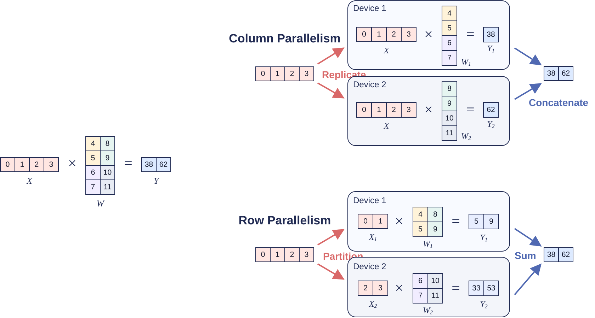

#### Example Network Implementation

In Qwen3-MoE, both the attention and MoE modules support TP. Consider `batch_size=1`, `seq_len=2048`, and `tp_size=4`, with hidden size `H=4096`, `Nq=64` query heads, `Nkv=4` KV heads, head dimension `D=128`, `E=128` experts, `top_k=8` experts per token, and expert intermediate size `I_moe=1536`. The global token count is `T=B*S=2048`.

**(1) Attention tensor parallelism**

Attention heads are largely independent, so each NPU can process a subset of them. In this example, Q/K/V projections are column-partitioned along their output dimension: the 64 query heads and four KV heads are distributed evenly across four ranks. The `o_proj` input dimension is row-partitioned to match the heads on each rank. Each rank produces a partial output with the full output width; one AllReduce sums those partial outputs.

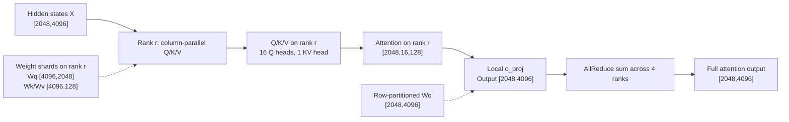

**(2) MoE expert tensor parallelism**

Qwen3-MoE also supports TP within an expert. Let $M$ be the number of tokens assigned to one expert; it varies with the routing results. Globally, `T*top_k=16384` token–expert assignments must be routed. Because one token's top-$k$ experts are distinct, $M$ ranges from 0 to 2048. Each expert is effectively an independent MLP.

The `gate_proj` and `up_proj` weights are both partitioned along the output dimension and are often combined into `w13_weight` before partitioning. The `down_proj` weight is partitioned along its input dimension. Intermediate activations remain on the current rank; only the partial `down_proj` outputs need to be summed by AllReduce.

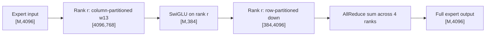

### 2.2 DP (Data Parallelism)

Data parallelism distributes inference requests or batches among multiple compute replicas. Each device stores the complete model weights, while the input is partitioned by request or along the batch dimension. Communication between devices within a layer is minimal, and each device independently maintains the KV cache for its assigned requests. Mixed short and long requests can, however, cause load imbalance; small batches may leave devices idle.

#### Example Network Implementation

For example, Qwen3-MoE combines TP and DP in its attention module. Attention TP normally partitions attention heads, so `attn_tp_size` must be compatible with the numbers of Q and KV heads and the head-partitioning rules.

Subject to those constraints, increasing TP reduces per-device computation and memory use but adds communication. Unlike DP, TP does not directly increase request concurrency. To maximize aggregate throughput, a deployment typically chooses a suitable `attn_tp_size` first, then sets `attn_dp_size = total_device_count // attn_tp_size`. Devices in one TP group cooperate on the same batch, each handling some attention heads; different DP replicas independently process disjoint batches. For example, eight NPUs with `attn_tp_size=4` form two DP replicas, each with four NPUs computing attention together via TP.

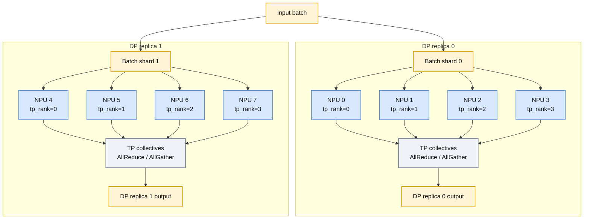

### 2.3 EP (Expert Parallelism)

Expert parallelism is a distributed strategy for mixture-of-experts (MoE) models. It places different experts on different devices so their computations can run in parallel. Input tokens are dynamically routed to the selected experts. After expert computation, the results return to the device holding each original token and are combined in the original token order. Depending on the routing scheme, communication across devices uses either AllGather + ReduceScatter or two AlltoAll operations.

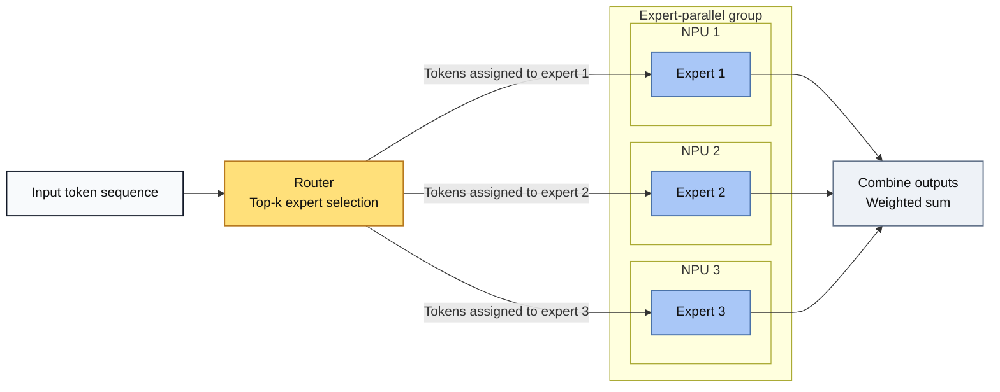

#### Example Network Implementation

With Qwen3-MoE and an EP degree of four, each device initially receives `T/4=512` tokens. Let `M_r` be the number of routed token copies ultimately assigned to rank `r`. It varies with routing and satisfies `0 <= M_r <= 16384`; the sum across all ranks is 16384.

**Option 1: AllGather + ReduceScatter**

This suits smaller EP groups where `top_k > EP_device_count`. First gather all tokens, then have each rank select the tokens for its local experts. After expert computation, reduce and scatter the outputs.


**Option 2: Double routing (AlltoAll + AlltoAll)**

First dispatch tokens to the ranks that own their selected experts, then return expert outputs to the original token-owning ranks. This suits larger EP groups where `EP_device_count > top_k` and reduces redundant computation.

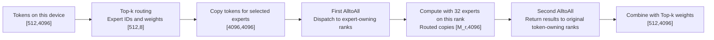

### 2.4 CP (Context Parallelism)

Context parallelism distributes the computation of a very long input sequence across devices. It addresses the high compute demand, memory pressure, and high TTFT of long-context prefill.

TP partitions weights and DP distributes independent requests; CP keeps the model parameters intact and partitions the sequence dimension (`seq_len`) of one long input across devices. For a sequence of length $L$ and `N=cp_size` devices, the sequence is divided into $2N$ contiguous segments. Each rank receives a pair of segments symmetric about the beginning and end of the sequence to balance the work across positions. Each rank generates queries, keys, and values for its local tokens. Queries stay local, while an AllGather collects local keys and values into global K/V. Each device then computes attention for its local queries against global K/V and retains only the outputs for the tokens it owns.

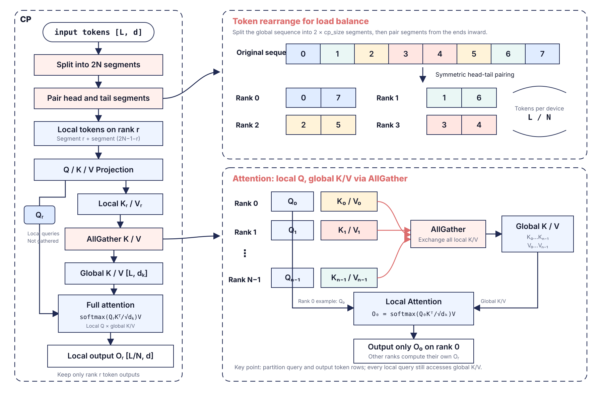

#### Example Network Implementation

In DeepSeek-V3.2-Exp, suppose `world_size=64`, `cp_size=64`, `attn_tp_size=1`, and `input_truncated_len=65536`. The sequence is split into 128 (`cp_size*2`) segments of 512 tokens each, so each rank computes 1024 query tokens. Rank 0 processes segments 0 and 127; rank 63 processes segments 63 and 64. This head–tail pairing balances causal-attention work: early segments have shorter visible histories, while late segments have longer ones. Paired on one rank, their total visible KV lengths are approximately equal across ranks. Input partitioning occurs before embedding; subsequent layers retain only the local queries and hidden states.

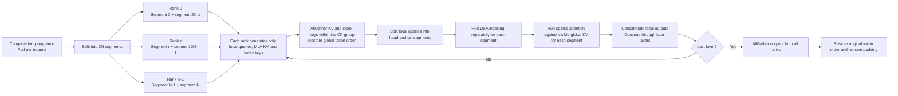

Within each attention layer, the MLA prolog and DSA indexer generate data only for local tokens. Separate AllGather operations within the CP group collect the MLA KV and index keys from all ranks. The gathered data is initially ordered by rank; the framework uses `restore_indices` to restore the original global token order. Queries remain local and do not participate in AllGather. The indexer and sparse attention process the head and tail query segments separately, each with its own causal visibility length. Concatenating their results preserves the local token layout, so subsequent layers, such as normalization and MoE, continue in parallel without reconstructing the full hidden state between layers.

Ignoring quantization, cache formats, and other parallel strategies, the core implementation can be summarized as follows:

```python
# Before entering the model, each rank selects a symmetric head–tail pair of token segments.
local_input_ids = global_input_ids.index_select(0, cp_metadata.local_indices)
local_hidden = embedding(local_input_ids)

# In each attention layer, queries stay local; only KV is gathered across ranks.
local_query, local_mla_kv = mla_prolog(local_hidden)
global_mla_kv = cp_all_gather(local_mla_kv)
global_mla_kv = global_mla_kv.index_select(0, cp_metadata.restore_indices)

# DSA index keys are gathered and reordered in the same way.
local_index_key = indexer_prolog(local_hidden)
global_index_key = cp_all_gather(local_index_key)
global_index_key = global_index_key.index_select(0, cp_metadata.restore_indices)

# The head and tail queries use different causal visibility lengths.
query_prev, query_next = split_head_tail(local_query)
topk_prev = dsa_index(query_prev, global_index_key, kv_len_prev)
topk_next = dsa_index(query_next, global_index_key, kv_len_next)
output_prev = sparse_attention(query_prev, global_mla_kv, topk_prev, kv_len_prev)
output_next = sparse_attention(query_next, global_mla_kv, topk_next, kv_len_next)
local_output = concat(output_prev, output_next)
local_hidden = remaining_layer_compute(local_output)

# Reconstruct the full sequence only after all decoder layers finish.
global_output = cp_all_gather(local_hidden)
global_output = global_output.index_select(0, cp_metadata.restore_indices)
global_output = global_output.index_select(0, cp_metadata.global_valid_indices)
```

The full KV exists only as a temporary computation view for the current prefill layer. When writing the persistent cache used by subsequent decoding, the implementation keeps only valid tokens and discards padding introduced for CP alignment. After all decoder layers, the model AllGathers hidden states from every rank, restores global token order, removes padding, and proceeds to final output generation.

### 2.5 SP (Sequence Parallelism)

Sequence parallelism partitions activations for long-sequence inference. It flattens the batch and sequence dimensions into one global token axis and distributes shards of that axis across devices. SP does not partition model weights itself, although TP can partition weights in the same group. For a global sequence length $L$ and `tp_size=N`, SP divides the sequence evenly within the TP group, so each device holds only a local shard of length $L/N$ between layers. Tokenwise operations such as LayerNorm, residual addition, and Dropout run on that local shard. Before attention, an AllGather restores the full token axis; each rank then computes its assigned heads. After attention, the result returns to a local sequence shard for subsequent computation.

The following figure shows the ReduceScatter path. Each rank applies a row-parallel `o_proj` to its local heads' attention results, then ReduceScatter sums the partial outputs and shards them along the sequence dimension. The figure omits `o_proj`, representing it in the transition from attention to ReduceScatter.

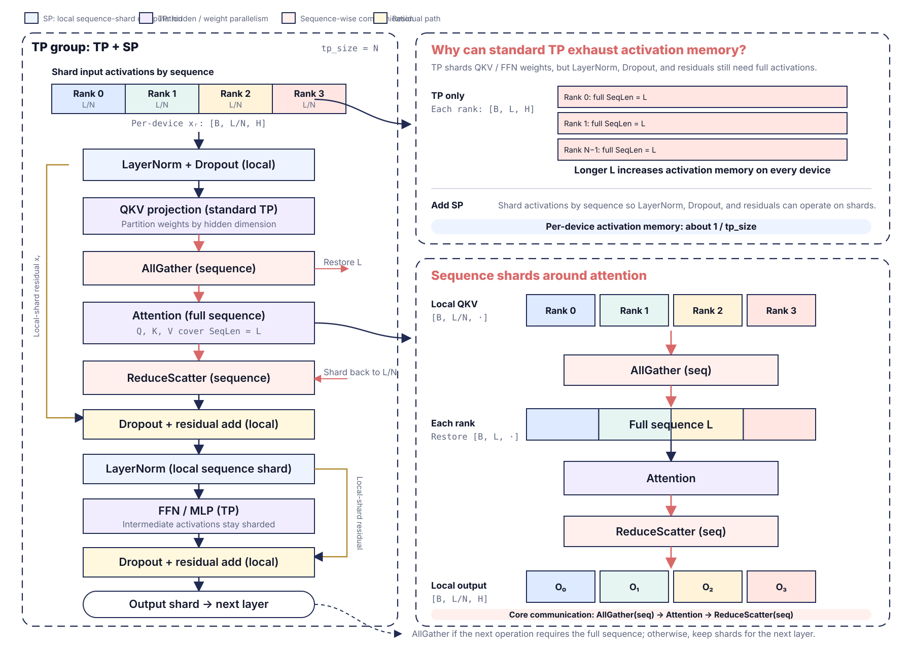

Another path performs AlltoAll after attention to transform the layout from “all tokens, local heads” to “local tokens, all heads.” After a local rearrangement, each rank applies the same complete `o_proj` weight to only its local tokens. Here AlltoAll exchanges the layout; it does not sum outputs from different heads. Both paths ultimately produce local sequence shards. The next figure expands the data flow around attention for the AlltoAll path.

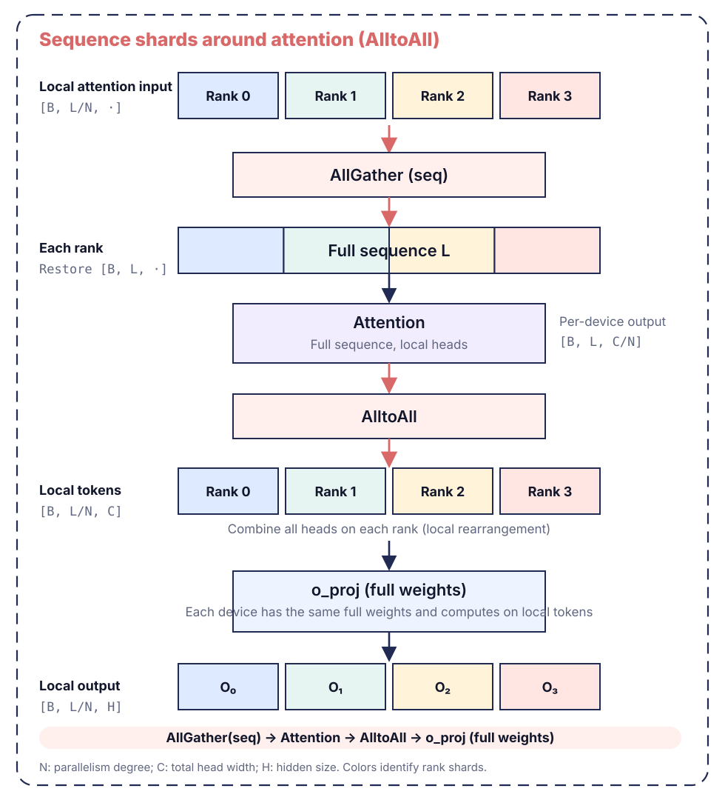

SP can reduce peak activation memory outside attention and improve the stability of long-sequence inference. By itself, it neither reduces the global KV required by attention nor removes the attention compute bottleneck for very long sequences.

#### Example Network Implementation

In the repository's DeepSeek-R1 configuration, SP uses 32 ranks with `attn_tp_size=32` and `enable_o_proj_alltoall: True`. In this implementation, SP and attention TP share a communication group: SP shards activations along the global token axis, while attention TP partitions heads during attention. With this configuration, the output projection follows the AlltoAll path described above.

The framework first packs requests in one prefill batch into a global token axis, padding the end if the token count is not divisible by the SP degree. After embedding, rank `r` keeps only the $r$th contiguous shard. If the padded token count is `T_pad` and the SP degree is `N`, each rank stores and processes only `T_pad/N` tokens between decoder layers. This distributes tokenwise computation and activations for normalization, residual connections, and feed-forward layers.

On entering attention, each rank first computes low-rank query features and MLA KV for its local tokens, then AllGathers each within the SP group. Every rank thus obtains attention inputs spanning the complete token axis but computes only its assigned heads. After attention, AlltoAll exchanges results among ranks. Local reshape and transpose operations change the layout from “all tokens, local heads” to “local tokens, all heads.” Each rank then applies the same complete `o_proj` weight to its local tokens and passes the resulting local sequence shard to the next layer.

```mermaid
flowchart LR
    T["Prefill batch<br />Pack into a global token axis"] --> PAD["Pad to a multiple of N"]
    PAD --> EMB["Embedding"]
    EMB --> SPLIT["Partition along the token axis<br />Each rank keeps one contiguous shard"]
    SPLIT --> LOCAL["Local tokenwise computation"]
    LOCAL --> PROJ["Generate local query features and MLA KV"]
    PROJ --> AG["AllGather within the SP group<br />Restore the full token axis"]
    AG --> ATT["Each rank computes attention for local heads"]
    ATT --> A2A["AlltoAll<br />Exchange attention outputs among ranks"]
    A2A --> O["Rearrange locally into all heads<br />Apply full-weight o_proj"]
    O --> NEXT{"Last layer?"}
    NEXT -- No --> LOCAL
    NEXT -- Yes --> OUTAG["AllGather outputs from all ranks"]
    OUTAG --> RESTORE["Restore global token layout<br />Read outputs at valid token positions"]
```

## 3. Summary: Choosing Parallelism for Different Workloads

TP partitions model weights, DP distributes inference requests, EP partitions MoE experts, and CP and SP partition the sequence dimension. A deployment should first identify its bottleneck—memory, compute, communication, or load imbalance—then combine the corresponding strategies. CANN graph execution, multi-stream scheduling, and HCCL communication optimization help realize the benefits of parallelism.

Guidelines based on model architecture, inference phase, and bottleneck:

1. **Low-latency decoding:** Prefer `TP + EP`. Each decode step generates few tokens, making memory access and communication costs prominent; avoid an unnecessarily large TP degree. Large weight layers, such as `o_proj` and the LM head, may use local TP independently to reduce memory pressure.
2. **High-throughput prefill:** Prefer `SP/CP + EP`. Prefill is compute-intensive and processes many tokens, so partitioning the sequence distributes long-sequence work.
3. **A single very long context:** Prefer `CP`. For an extremely long single request, CP can substantially reduce per-device attention computation and peak activation memory.
4. **Mixed request lengths or variable sequence lengths:** Prefer `SP`. Flattening the batch and sequence dimensions and distributing tokens evenly reduces load imbalance caused by differing request lengths.
5. **MoE models:** Include `EP`. Expert modules are naturally distributable; focus on the communication costs of expert dispatch and aggregation.
6. **Sufficient batch size and similar request lengths:** Consider `DP`. It provides stable throughput with very little communication within a layer, but device utilization falls when there are too few requests.
