# 模型切分方式概述：TP / DP / EP / CP / SP
## 1. 概述
大模型推理场景下，单张硬件卡通常无法同时满足权重存储容量、KV Cache 显存占用、长序列首包延迟（TTFT）、解码阶段低时延、MoE 专家负载均衡等多重需求，因此需要将模型计算逻辑拆分至多卡并行执行。各类并行切分方案本质是解决同一核心问题：选择哪一类数据维度分配至不同计算卡（rank）进行处理。

| 切分方式 | 主要切分维度 | 核心作用 | 典型应用层 |
|---|---|---|---|
| TP | 张量/模型权重 | 降低单卡权重存储量与单卡计算量 | Attention 多头、输出投影 o_proj、MLP 隐藏层、输出头 LM Head |
| DP | 推理请求/批量 batch | 提升整体推理吞吐，减少层内跨卡通信 | 多请求并发、批量充足场景 |
| EP | MoE 专家模块 | 分摊专家权重存储、分散专家计算负载 | 专家路由、分组矩阵乘、专家分发/聚合 |
| CP | 序列维度 | 支持超长上下文，降低激活和 Attention 显存 | 超长文本 Prefill、深度稀疏注意力 DSA |
| SP | 序列维度 | 降低 TP 下未被切分算子的激活显存 | 通用 Prefill、SP-TP-SP 混合并行、序列维度 AlltoAll 通信 |

实际线上部署极少单独使用某一种并行策略，主流组合方案包含 `TP + EP`、`SP + TP + EP`、`CP + EP + 局部 TP`。多卡并行的端到端时延收敛效果，由昇腾 CANN 多流调度、HCCL 集合通信、计算图模式、算子融合能力共同决定。

## 2. 切分方式与典型网络并行实现样例

以下网络并行实现样例仅用作说明，详细优化策略见 [Qwen3-MoE 优化文档](../../models/qwen3_moe/qwen3_moe_optimization.md)、[DeepSeek-R1 优化文档](../../models/deepseek_r1/deepseek_r1_prefill_optimization.md)和 [DeepSeek-V3.2-Exp 优化文档](../../models/deepseek_v3_2_exp/deepseek_v3.2_exp_inference_guide.md)。

### 2.1 TP (Tensor Parallelism，张量并行)

张量并行将单层 Transformer 内部权重张量、矩阵乘法沿指定维度拆分至多张 NPU。并行度为 $N$ 时，每张卡仅存储完整权重的 $1/N$ 切分结果、仅执行对应的子矩阵运算，最终通过集合通信（AllGather / AllReduce）聚合得到完整计算结果。
在前向传播中，线性层要计算 $Y = X @ W$，$X$、$Y$ 分别是网络中这一层的输入和输出激活值，$W$ 是这一层对应的模型权重参数。根据权重 $W$ 切分维度的不同，张量并行分为列并行和行并行两种模式，适配网络中不同功能层的运算特性（参考下图图示）：
1. 列并行：就是把参数矩阵 $W$ 按照列的维度分开，存放在两个（或多个）计算节点上分别计算对应部分的矩阵乘法。此时对于输入激活值 $X$，需要将其整个拷贝到这两个节点上；对于输出激活值 $Y$，需要将这两个节点的输出 $Y_1$、$Y_2$ 拼接在一起来获得。该方式适配 Attention QKV 投影层、MLP gate/up 层，这类层需要扩充特征维度，结合多头注意力的分头计算特性，可实现算力均匀拆分。

2. 行并行：就是把参数矩阵 $W$ 按照行的维度分开，存放在两个（或多个）计算节点上分别计算。此时对于输入激活值 $X$，也将其按照对应维度切分到这两个节点上；而要得到完整的输出激活值 $Y$，需要将这两个节点的输出 $Y_1$、$Y_2$ 逐元素求和。该方式适配 Attention `o_proj` 输出投影层、MLP down 层，符合这类网络层特征聚合、维度收敛的运算逻辑。
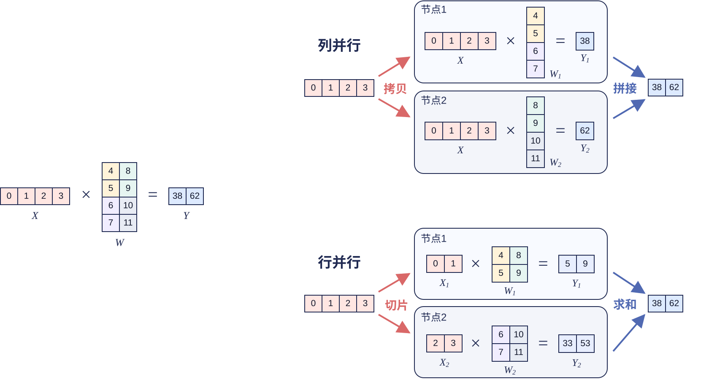
#### 具体网络实现样例
在 Qwen3-MoE 中，Attention 和 MoE 模块都适配了张量并行。其中 `batch_size=1`、序列长度 `seq_len=2048`、并行规模 `tp_size=4`；模型维度为隐藏层 `H=4096`、查询头数 `Nq=64`、KV 头数 `Nkv=4`、单头维度 `D=128`、专家总数 `E=128`、每 Token 激活专家数 `top_k=8`、专家中间维度 `I_moe=1536`。全局 Token 数 `T=B*S=2048`。

**（1）Attention 张量并行**

在 Attention 模块，多头注意力的不同 head 相对独立，可以让每张 NPU 计算一部分 head。本样例中 Q/K/V 投影沿输出维度进行列切分，64 个 Query Head、4 个 KV Head 均衡分配至 4 个 rank；`o_proj` 沿输入维度行切分，与各 rank 注意力头一一对应。各 rank 的 `o_proj` 局部输出维度一致，经由一次 AllReduce 求和聚合得到完整输出。

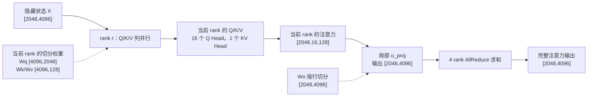

**（2）MoE 专家张量并行**

Qwen3-MoE 也支持专家的张量并行，其中单专家分配到的 Token 数量为 $M$，数值由路由结果动态变化；全局需要路由的 Token 总量 `T*top_k=16384`，单 Token 分配的 Top-$k$ 专家互不重复，因此单专家 $M$ 取值区间为 0～2048。单个专家等价于独立 MLP 结构。
单个专家的 `gate_proj` 和 `up_proj` 均沿输出维切分，因此常常合并为 `w13_weight` 一起切分；`down_proj` 沿输入维切分。中间激活始终保留在当前 rank，只有 `down_proj` 的局部输出需要 AllReduce 求和。

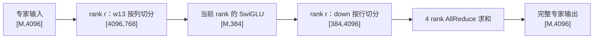

### 2.2 DP (Data Parallelism，数据并行)

数据并行是指将推理请求或输入的数据按照 batch 维度分发给多个计算副本；数据并行下每张卡存储完整模型权重，仅在输入维度按推理请求、批量 batch 做切分。其优势是层内跨卡通信量极低，KV Cache 随各卡独立请求自然分摊；而缺点是长短文本请求混合部署时易出现负载不均衡，批量请求不足时会存在硬件空闲。

#### 具体网络实现样例

以 Qwen3-MoE 为例，其 Attention 模块采用张量并行（TP）与数据并行（DP）组合的分布式并行策略。Attention 张量并行默认沿注意力头维度切分，因此 attn_tp_size 必须与 Q/KV Head 总数、多头切分规则匹配。
在满足注意力头切分约束的条件下，调大 TP 并行度能够分摊单卡的计算负载与显存占用，但会引入额外跨卡通信开销；同时 TP 无法像 DP 那样直接提升推理并发能力。为最大化整体吞吐，工程上一般先选定合理的 attn_tp_size，再通过 attn_dp_size = 总设备数 // attn_tp_size 确定数据并行规模。同一 TP 组内的多张设备协同处理同一批次请求，各自负责一部分注意力头；不同 DP 副本相互独立，分别处理互不重叠的批量请求。例如：共计 8 张 NPU，设置 attn_tp_size=4 时，可拆分出 2 组独立 DP 副本；每组副本内部由 4 张 NPU 以张量并行协同完成 Attention 计算。

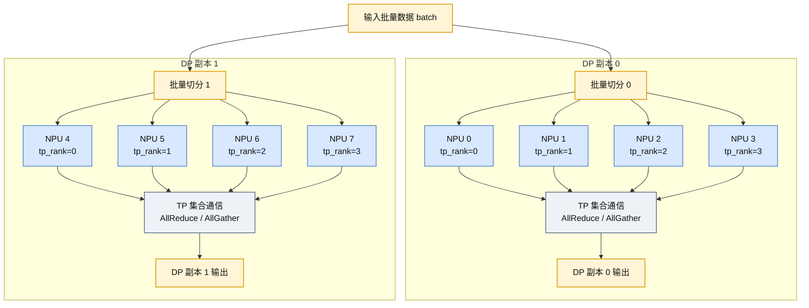

### 2.3 EP (Expert Parallelism，专家并行)

专家并行是 MoE 混合专家模型专属分布式并行方案，其主要思想就是将不同专家放在不同计算节点上进行并行计算。输入数据需要通过动态路由机制分发给相应专家；专家计算完成后，再将结果送回原 Token 所在卡并按原顺序合并。跨卡通信可根据路由方案选择 AllGather + ReduceScatter 或两次 AlltoAll。

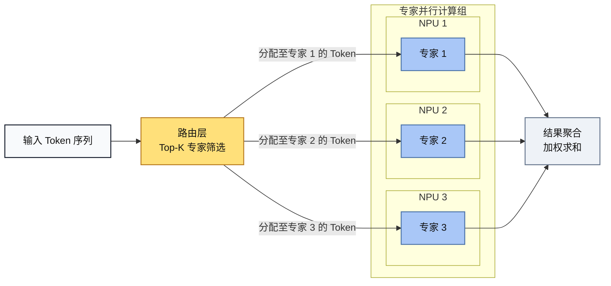

#### 具体网络实现样例

以 Qwen3-MoE 为例，EP 并行规模为 4，单卡初始分配 Token 数 `T/4=512`。变量 `M_r` 代表分发后第 `r` 张卡实际承载的 Token 路由副本数，数值随路由逻辑动态变化，满足约束 `0 <= M_r <= 16384`、所有卡副本总数之和等于 16384。

**方案一：AllGather + ReduceScatter**
适配 EP 并行规模较小、`top_k > EP_device_count` 的场景，先聚合全局 Token 再由当前 rank 筛选专家，计算完成后归约分发输出。
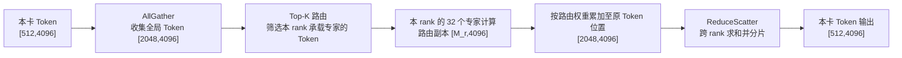

**方案二：双路由（AlltoAll + AlltoAll）**
先按专家归属分发 Token，专家计算完成后回传至原处理卡，适配 EP 规模更大、`EP_device_count > top_k` 的场景，减少冗余计算。
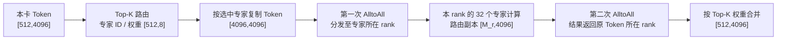

### 2.4 CP (Context Parallelism，上下文并行)

CP 是面向超长文本序列设计的分布式并行策略，核心解决超长上下文预填充阶段算力密集、显存溢出、首包延迟过高问题。
与 TP 拆分权重、DP 拆分独立推理请求不同，CP 不拆分模型参数，仅对单条超长输入序列的时序维度 `seq_len` 均匀切分，将完整上下文分段分发至多卡并行处理。
具体过程如下图所示：长度为 $L$ 的输入序列首先被均分为 $2N$ 个连续片段，其中 `N=cp_size` 为参与计算的卡数。每个 rank 负责首尾对称的两个片段，以均衡不同序列位置的计算负载。各 rank 基于本地 Token 生成 Query、Key 和 Value，其中 Query 始终保留在本卡，局部 Key 和 Value 则通过 AllGather 通信汇聚为全局 K/V。随后，每张卡使用本地 Query 与全局 K/V 独立计算完整注意力，并仅保留其负责 Token 对应的输出。
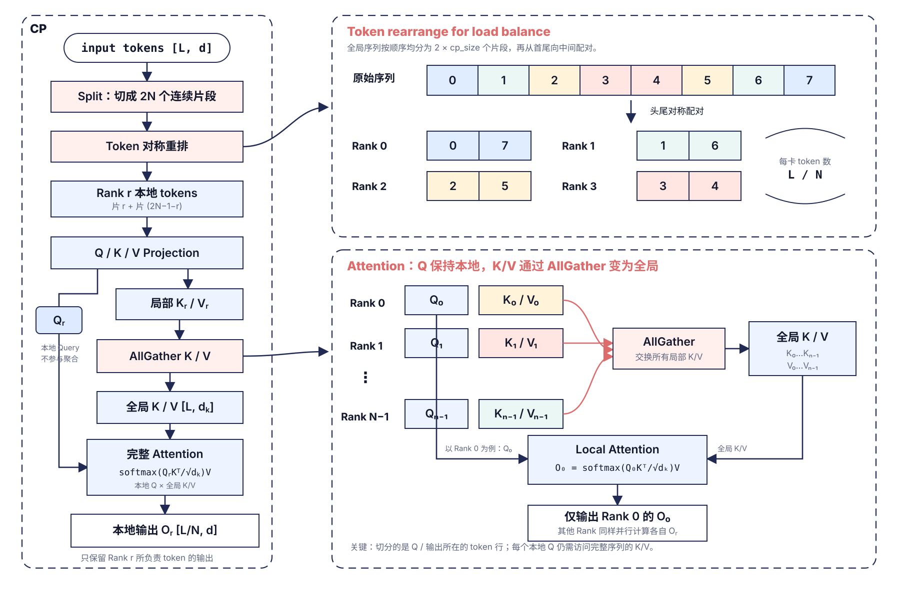

#### 具体网络实现样例
以 DeepSeek-V3.2-Exp 为例，`world_size` 和 `cp_size` 均设为 64、`attn_tp_size=1`、`input_truncated_len=65536`，序列被切成 128（`cp_size*2`）段，每段 512 Token，每个 rank 实际计算 1024 个 Query Token：rank 0 处理第 0、127 段，rank 63 处理第 63、64 段。这种首尾配对用于均衡因果注意力的计算量。靠前片段可见的历史较短，靠后片段可见的历史较长；将两者分配给同一 rank 后，各 rank 需要处理的可见 KV 总量基本一致。输入切片在进入 Embedding 前完成，后续各层始终只保留本 rank 的 Query 和隐藏状态。

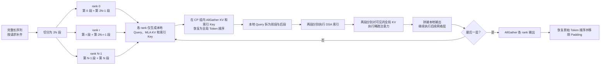

每个注意力层内，MLA Prolog 和 DSA 索引器只为本地 Token 生成数据，再分别通过 CP 组的 AllGather 收集各 rank 的 MLA KV 和索引 Key。通信结果最初按 rank 排列，框架使用 `restore_indices` 将其恢复为原始的全局 Token 顺序。Query 不参与 AllGather，仍留在本地；索引器和稀疏注意力把本地 Query 分成首、尾两组，并使用各自的因果可见长度访问全局 KV。两组结果拼接后仍是本地 Token 布局，因此后续归一化、MoE 等网络层继续并行计算，不需要在层间恢复完整隐藏状态。

省略量化、缓存格式和其他并行策略后，核心实现可概括为：

```python
# 进入模型前：每个 rank 选取首尾对称的两个 Token 片段。
local_input_ids = global_input_ids.index_select(0, cp_metadata.local_indices)
local_hidden = embedding(local_input_ids)

# 每个注意力层：Query 留在本地，只聚合所有 rank 的 KV。
local_query, local_mla_kv = mla_prolog(local_hidden)
global_mla_kv = cp_all_gather(local_mla_kv)
global_mla_kv = global_mla_kv.index_select(0, cp_metadata.restore_indices)

# DSA 索引 Key 采用相同的聚合与顺序恢复方式。
local_index_key = indexer_prolog(local_hidden)
global_index_key = cp_all_gather(local_index_key)
global_index_key = global_index_key.index_select(0, cp_metadata.restore_indices)

# 首、尾两段 Query 使用不同的因果可见长度，分别完成索引和注意力。
query_prev, query_next = split_head_tail(local_query)
topk_prev = dsa_index(query_prev, global_index_key, kv_len_prev)
topk_next = dsa_index(query_next, global_index_key, kv_len_next)
output_prev = sparse_attention(query_prev, global_mla_kv, topk_prev, kv_len_prev)
output_next = sparse_attention(query_next, global_mla_kv, topk_next, kv_len_next)
local_output = concat(output_prev, output_next)
local_hidden = remaining_layer_compute(local_output)

# 所有 Decoder 层完成后再恢复完整序列。
global_output = cp_all_gather(local_hidden)
global_output = global_output.index_select(0, cp_metadata.restore_indices)
global_output = global_output.index_select(0, cp_metadata.global_valid_indices)
```

完整 KV 只作为当前 Prefill 层的临时计算视图。写入后续 Decode 所用持久化缓存时，代码仅保留有效 Token，并丢弃为 CP 对齐引入的 Padding。所有 Decoder 层结束后，模型才 AllGather 各 rank 的隐藏状态，按全局 Token 顺序恢复并移除 Padding，再进入最终输出阶段。


### 2.5 SP (Sequence Parallelism，序列并行)

SP 是面向长序列推理的轻量化序列切分优化方案。它将 batch 维度与 sequence 维度合并为全局序列轴，再沿该轴将激活切分后分配至多卡；SP 本身不切分模型权重，配合使用的 TP 仍可切分权重。以全局序列长度为 $L$、张量并行度 `tp_size=N` 为例，SP 在 TP 分组内均匀切分序列，使每张设备在层间仅持有长度为 $L/N$ 的局部序列分片。LayerNorm、残差连接、Dropout 等逐 Token 算子在本地分片上执行。进入 Attention 前，通过 AllGather 聚合注意力输入，恢复完整 Token 轴；各 rank 再计算自己负责的 Head。Attention 之后，需要将计算结果恢复为局部序列分片，供后续计算使用。

下图展示采用 ReduceScatter 的路径：各 rank 先对局部 Head 的注意力结果执行行并行 o_proj，再通过 ReduceScatter 对部分结果求和，并沿序列维切回本地分片。图中省略了 o_proj，将其合并在 Attention 到 ReduceScatter 之间的流程中。

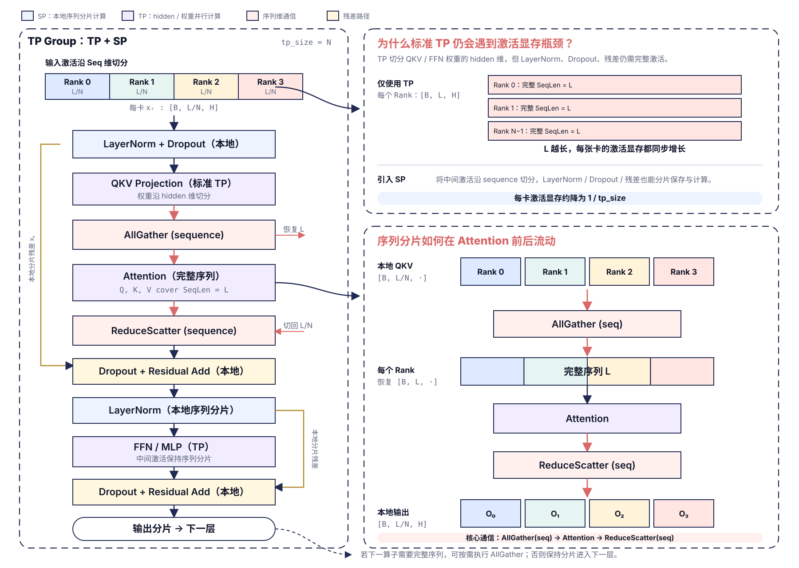

另一种路径在 Attention 之后先执行 AlltoAll，将“全局 Token、局部 Head”的布局转换为“本地 Token、完整 Head”；经过本地重排后，各 rank 用相同的完整 o_proj 权重，只对自己负责的 Token 执行输出投影。AlltoAll 在这里负责交换数据布局，不对不同 Head 的结果求和。两条路径最终都得到本地序列分片；下图仅展开 AlltoAll 路径在 Attention 前后的数据流。

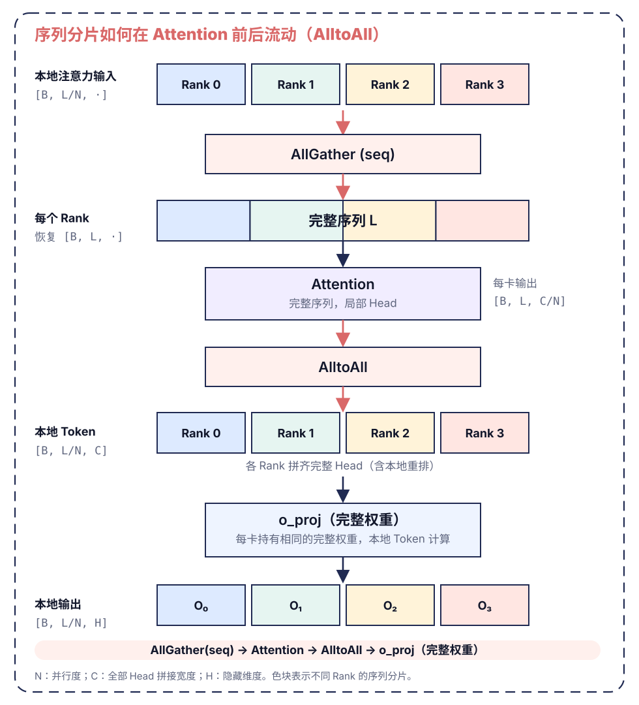

SP 可以降低非注意力模块的激活显存峰值，提升长序列推理稳定性；它本身不减少注意力所需的全局 KV，也无法消除超长序列的注意力算力瓶颈。

#### 具体网络实现样例
以 DeepSeek-R1 为例。仓库中的 SP 配置使用 32 个 rank，并令 `attn_tp_size=32`、`enable_o_proj_alltoall: True`。在当前实现中，SP 与 Attention TP 复用同一个通信组：SP 负责沿全局 Token 轴切分激活，Attention TP 负责在注意力计算中切分 Head。启用该配置后，输出投影使用上述 AlltoAll 路径。

框架先将一个 Prefill 批次中的请求打包为全局 Token 轴；若 Token 总数不能被 SP 规模整除，则在末尾补齐。Embedding 完成后，rank `r` 只保留全局 Token 轴上的第 $r$ 个连续分片。设补齐后的 Token 总数为 `T_pad`、SP 规模为 `N`，则每个 rank 在 Decoder 层间只保存并计算 `T_pad/N` 个 Token，从而均分归一化、残差连接和前馈网络等逐 Token 计算及其激活。

进入注意力时，每个 rank 先基于本地 Token 计算 Query 的低秩中间特征和 MLA KV，再在 SP 通信组内分别执行 AllGather。AllGather 后，各 rank 都获得覆盖完整 Token 轴的注意力输入，但只计算自己负责的注意力 Head。注意力结束后，AlltoAll 交换各 rank 的结果，再通过本地 reshape 和 transpose 将布局从“全局 Token、局部 Head”转换为“本地 Token、完整 Head”。随后，每个 rank 使用完整且相同的 o_proj 权重对本地 Token 做输出投影，得到本地序列分片，供下一层继续计算。

```mermaid
flowchart LR
    T["Prefill 批次<br />合并为全局 Token 轴"] --> PAD["补齐到可被 N 整除"]
    PAD --> EMB["Embedding"]
    EMB --> SPLIT["沿 Token 轴均分<br />每个 rank 保留一个连续分片"]
    SPLIT --> LOCAL["本地逐 Token 计算"]
    LOCAL --> PROJ["生成本地 Query 中间特征和 MLA KV"]
    PROJ --> AG["SP 组内 AllGather<br />恢复完整 Token 轴"]
    AG --> ATT["各 rank 计算局部 Head 的注意力"]
    ATT --> A2A["AlltoAll<br />交换各 rank 的注意力输出"]
    A2A --> O["本地重排为完整 Head<br />执行完整权重 o_proj"]
    O --> NEXT{"最后一层？"}
    NEXT -- 否 --> LOCAL
    NEXT -- 是 --> OUTAG["AllGather 各 rank 输出"]
    OUTAG --> RESTORE["恢复全局 Token 布局<br />按有效 Token 位置读取输出"]
```

## 3. 总结：不同业务场景并行组合策略
TP 拆分模型权重、DP 拆分推理请求、EP 拆分 MoE 专家模块、CP 和 SP 拆分序列维度。工程落地需先定位系统瓶颈（显存、算力、通信、负载不均衡），再组合对应并行方案，同时通过 CANN 图模式、多流调度、HCCL 通信优化释放并行收益。

结合模型结构、推理阶段、瓶颈类型的并行选型指南：
1. **解码阶段（Decode）低时延需求**：优先 `TP + EP`。解码单步生成 Token 数量少，访存、通信开销敏感，TP 并行规模不宜过大；o_proj、LM Head 等大权重层可单独使用局部 TP 降低显存压力。
2. **预填充阶段（Prefill）高吞吐需求**：优先 `SP/CP + EP`。预填充 Token 总量大、计算密集，沿序列维度切分可分摊长序列算力。
3. **超长单文本上下文场景**：优先 `CP`。单请求序列极长时，CP 可大幅降低单卡注意力计算量与激活显存峰值。
4. **长短请求混合、序列长度不固定场景**：优先 `SP`。合并批量与序列维度后按 Token 均分，消除请求长度差异带来的负载倾斜。
5. **MoE 混合专家模型**：优先搭配 `EP`。专家模块天然适合分布式拆分，重点优化专家分发、聚合阶段跨卡通信。
6. **批量请求充足、单请求长度均匀场景**：可选用 `DP`。层内通信开销极低，吞吐稳定；批量不足时硬件利用率会明显下降。
