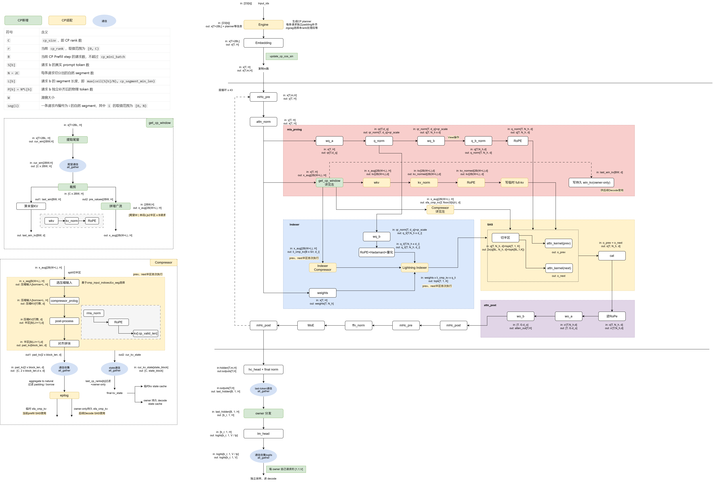

# DeepSeek-V4 Prefill CP 多 Batch 设计文档

## 背景与设计目标

### 背景

DeepSeek-V4 Prefill 的长序列 Attention、Window KV 和压缩 KV 计算量较大。Context Parallel（CP）把每条请求的 token 沿序列维切到多个 rank，并用 head-tail zigzag 分配平衡因果 Attention 的负载。改造前的单请求 CP 存在四方面局限：

1. 调度和临时 cache 路径仅支持 `cp_mini_batch == 1`，无法处理多请求 Prefill；
2. 单请求切分后单 rank 的算子规模有限，调度与通信开销占比较高；
3. owner 语义未与 Scheduler 的请求分配、持久化和 Decode 链路完整衔接；
4. 层内存在基于 device tensor 的动态 shape 推导，不满足 `npugraph_ex` 图模式的静态要求。

本设计将 CP Prefill 扩展为多请求，并通过静态 planner 管理变长请求的布局、索引和通信形状。

### 设计目标

1. 一个 CP Prefill step 支持 `B > 1`，且不同请求长度可以不同；
2. 所有 CP rank 对同一批请求协同计算，但每条请求只在一个 owner rank 持久化并进入 Decode；
3. 每个 Prefill step 内，Window、compressed KV、compressor state 和 last-token 通信使用固定形状载荷；
4. padding、跨 segment overlap 和跨请求边界具有显式的有效行语义；
5. 在 DecoderLayer 外完成索引和通信形状规划，层内只消费固定 tensor 和 host shape；
6. 主模型和 MTP 共享同一 CP 请求布局及 owner 语义。

## 特性亮点

- **变长请求按请求独立补齐：** Scheduler 按 `cp_mini_batch` 和 `max_prefill_tokens` 选择请求；Engine 为每条请求独立计算物理 segment 长度，padding 不跨请求复用。
- **Head-tail zigzag：** 每条请求切分为 `2C` 个自然 segment，rank `r` 处理 `seg(r)` 和 `seg(2C-r-1)`，使各 rank 的因果 Attention 计算量近似均衡。
- **公共与模型私有计划分层：** Engine 生成公共 `PrefillCPMetaData`；DeepSeek-V4 在模型预处理阶段补充 Window、Indexer、Compressor 和 last-token 计划。
- **固定形状的 CP 通信：** Window、compressed KV、Compressor state 和 last-token 在每个 Prefill step 内由 planner 确定载荷形状，并通过各自的恢复计划还原 natural 顺序或完成 owner 写回。
- **Owner 持久化：** 所有 rank 协同完成 Prefill，只有 owner rank 写入持久 cache、采样并进入 Decode；Decode 阶段保持 owner-local。
- **MTP 复用请求布局：** 主模型 owner 采样的 next token 通过 CP group 的一次 all-reduce 同步到各 rank，MTP 沿用同一套 padded/compact 转换和 owner 语义。

## 术语、坐标系与长度契约

### 术语表

本表列出 CP 多请求适配引入的术语；DeepSeek-V4 模型结构术语（SAS、Lightning Indexer、C4/C128 Compressor 等）参见 [DeepSeek-V4 推理指南](./deepseek_v4_inference_guide.md)。

| 术语 | 含义 |
| --- | --- |
| CP（Context Parallel） | 沿序列维切分请求的并行方式；本方案中各 rank 协同计算同一批请求，每条请求由一个 owner rank 持久化 |
| planner | 进入 DecoderLayer 前完成坐标、索引、长度与 collective 形状规划的 Host 侧规划层；公共部分由 `ExecutionEngine._apply_prefill_cp()` 生成，V4 私有部分由 `DeepseekV4PrefillCPMetaData.from_forward_metadata`、`build_prefill_cp_window_plan` 和 `AttentionData.get_cp_metadata()` 等模型侧代码补全，是「Planner 前移」原则的载体 |
| TND | token 行布局；本文以 T 维 token 行作为坐标单位，五类布局的行数和排列顺序可能不同 |
| owner rank | 请求的持久化与解码责任方（`request.cp_rank`），与 `last_cp_ranks[b]` 是两个独立概念 |
| `last_cp_ranks[b]` | 请求 b 的最后 token 和最终 state 的计算 rank；不表示 owner 或持久化 rank |
| zigzag | head-tail 配对切分：rank r 取第 r 个与第 N-r-1 个 segment |
| augmented hidden | `[上一自然段尾窗, 当前 segment]` 拼接的增广输入流，供 WKV 与 Compressor 消费 |
| borrow（借入） | Compressor 为对齐压缩分组边界，从同一请求上一自然段借入的前置 token 行 |

### 基本符号

```text
B       = 当前 CP Prefill step 的请求数
C       = cp_size
r       = 当前 cp_rank，0 <= r < C
N       = 2 * C，每条请求的自然 segment 数
S[b]    = 请求 b 的真实 prompt 长度
L[b]    = max(ceil(S[b] / N), cp_segment_min_len)
P[b]    = N * L[b]，请求 b 的补齐后物理长度
W       = sliding window 大小
V[b,s]  = 请求 b 的自然 segment s 的真实有效 token 数
```

DeepSeek-V4 模型将 `cp_segment_min_len` 设置为 `W`，用于满足 Window kernel 的最低物理长度要求。

### 五类行坐标

| 坐标 | 排列 | 主要用途 |
| --- | --- | --- |
| compact TND | 各请求真实 token 首尾相接 | Scheduler 输入、持久 cache 原始 mapping |
| padded natural TND | 每条请求独立补齐，request-major、segment-major | CP 全局规划、MTP compact/padded 转换 |
| local CP TND | 当前 rank 的 `[prev_B, next_B]` | Embedding、DecoderLayer 的当前 Q |
| augmented local TND | 每个非首段为 `[上一自然段尾窗, 当前 segment]` | WKV、SFA/LI Compressor |
| rank-major collective | `[rank0.prev, rank0.next, rank1.prev, ...]` | Window、compressed KV 等载荷的 CP all-gather；state 使用独立的 `state_write_plans` |

Window、compressed KV 和 last-token 载荷分别使用专用恢复计划：

- Window：`window_value_source_indices`；
- compressed KV：`aggregate_to_natural`；
- last-token：`last_token_gather_rows`。

`gather_to_natural` 是公共 `restore_indices` 的 V4 别名，用于将 rank-major 行恢复到 natural 顺序；Window、compressed KV 和 last-token 仍使用各自的专用索引。

### Q 与 Compressor 的长度契约

对于短请求或尾部不完整 segment，同时保留物理行边界和真实有效长度：

| 字段 | 语义 |
| --- | --- |
| `cu_seq_lens_q` | 每个 prev/next 物理 segment 的 TND 边界，按 `L[b]` 累加并包含 segment 尾部 padding |
| `seq_used_q` | 当前 segment 的真实有效 Q 长度，即 `V[b,s]` |
| `cmp_seq_used_q[ratio]` | Compressor 的有效输入长度，即 `V[b,s] + comp_len`；空 segment 为 0 |
| `actual_seq_k` | V4 私有 attention plan 中当前 segment 可见的逻辑 KV 长度，按请求真实长度裁剪 |

`seq_used_q` 使用真实 `V[b,s]`，物理边界使用 `L[b]`。该组合保持物理 tensor shape 固定，并将 segment 尾部 padding 排除在 Sparse Flash MLA 和 Lightning Indexer 的有效 query 之外。

### Padding 语义

| Padding 类型 | 值或标记 | 是否允许写持久 cache |
| --- | --- | --- |
| request segment padding | Engine 使用 `input_ids=0`；V4 预处理将 padding 的 `position_ids` 设为 `1`，由 valid length 排除 | 否 |
| Window 左侧 padding | hidden 为 0，slot 为 `-1` | 否 |
| Compressor aggregate padding | payload 为 0，slot 为 `-1` | 否 |
| borrowed compressed output | 仅用于跨段分组连续性，slot 为 `-1` | 否 |

padding 有效性由 valid length、valid row index 或 `slot == -1` 判定；token 值、position id 和物理行号不作为有效性依据。

## 总体架构与责任边界

### CP 多请求整体流程

<p align="center">
  
</p>

图 1：DeepSeek-V4 Prefill CP 多 Batch 整体流程

流程图以 Engine、DecoderLayer 循环和模型输出为主干，左侧展开 `get_cp_window` 与 Compressor 的通信细节，右侧展开 MLA Prolog、Lightning Indexer、SAS 和 Attention Post 的层内关系。 绿色模块表示 CP 新增逻辑，浅黄色模块表示既有模型路径上的 CP 适配，蓝色椭圆表示 CP collective。阅读时可沿中间主干自上而下理解请求布局变化，再分别查看 Window、压缩 KV/state 和 last-token 三类通信载荷。

### 设计原则

设计原则如下：

1. **Planner 前移，层内纯消费。** 坐标、索引、长度和 collective 形状在进入 DecoderLayer 前生成；层内不执行基于 device tensor 的 shape 推导或 host 同步操作（如 `.item()`、`is_nonzero()`）。
2. **定容通信。** 所有 CP collective 在通信前确定载荷形状并完成补零，rank 间不交换动态 shape。
3. **显式有效行语义。** padding、borrow 和跨请求边界通过 valid length、valid row index 或 `slot == -1` 表达，不使用 token 值、position id 或物理行号推断有效性。
4. **计算与持久化分离。** 所有 rank 协同计算整批请求，只有 owner rank 写入持久 cache、采样并进入 Decode；temporary cache 与 persistent cache 独立编址。

### 端到端数据流

```text
Scheduler
  -> 为请求分配 cp_rank owner
  -> 选择不超过 cp_mini_batch 和 max_prefill_tokens 的请求

ExecutionEngine._apply_prefill_cp
  -> compact TND 转 request-major padded natural TND
  -> 构造公共 CP local/restore/valid 索引、临时编址与 owner mapping
  -> 生成公共 PrefillCPMetaData

ModelWorker.inference
  -> 通过已有 preprocess_model_inputs hook 进入模型预处理

DeepSeek-V4.preprocess_model_inputs
  -> prepare_prefill_cp_inputs 补全模型私有 metadata
  -> 从公共 cumulative Q 长度差分取得 segment 长度
  -> 生成 V4 segment、last-token、Window 和 Indexer 计划
  -> 将 V4 的 padding position 设为 1，保留真实 position

AttentionData
  -> 创建本次 Prefill 的 full-KV 临时工作区
  -> 展开 prev/next Attention metadata
  -> 创建 compressed KV/state 临时工作区
  -> 补全 per-ratio Compressor 与 state 写回计划

DecoderLayer
  -> Window tail all-gather，生成 augmented hidden 和 final window
  -> MLA Q/KV、temporary full-KV、owner persistent win_kv
  -> SFA/LI Compressor all-gather 和 owner persistent 写回
  -> Lightning Indexer prev/next 两次检索
  -> SAS prev/next 两次 Attention

模型出口
  -> last-token 定容 all-gather
  -> request-major 全局 logits
  -> Engine 仅选择 owner 行采样和更新请求
  -> owner-local Decode；可选 MTP 使用全局恢复后的 next token
```

### 通信模式汇总

下表所列 CP 相关通信均为 planner 定容的集合通信：载荷形状在各 rank 上一致，通信前完成补零。这是本方案在 `npugraph_ex` 图模式下运行的关键条件之一。

| 通信点 | 执行时机 | collective 与载荷形状 | 恢复计划 |
| --- | --- | --- | --- |
| Window 尾窗 | 每 DecoderLayer 入口（`get_cp_window`） | all-gather，每 rank `[2*B*W, H]` | `window_value_source_indices` |
| compressed KV | 每层 Compressor | all-gather，每 rank `[2*block_len, D]`（prev/next 半区各补齐到 `block_len`） | `aggregate_to_natural` |
| compressor state | 每层 Compressor | all-gather，固定形状 state 载荷 | `state_write_plans`（按 `last_cp_ranks` 选取来源 rank） |
| last-token hidden | 模型出口，每 step 一次 | all-gather，每 rank `[capacity, H]` | `last_token_gather_rows` |
| MTP 输入 token | 主模型 owner 采样后、MTP 运行前，每 step 一次 | all-reduce，将 owner 行的主模型 next token scatter 到 `[B, ...]` 零张量后求和 | —（结果即各 rank 一致的 MTP 输入 token） |

在下表列出的 CP 相关通信中，MTP all-reduce 是唯一的求和语义通信，其余为数据搬运语义的 all-gather。

### Planner 的分层职责

公共 CP 契约先构建，DeepSeek-V4 再补全私有计划。公共 `PrefillCPMetaData.kv_len_prev/next` 保持
请求补齐后的物理 prefix 坐标，这是 V3.2、GLM-5、Kimi 等模型的既有 FA/Indexer 输入契约；
executor 层保留该物理 prefix 坐标。V4 在 `cp_metadata.py` 生成私有 metadata 时，才把这两个字段
转换为逻辑真实长度；因此下表的 `actual_seq_k` 只描述 V4 私有 plan，不代表公共字段的语义。

各阶段的函数入口、代码位置、职责及调用时机如下：

| 阶段 / 函数 | 代码位置 | 用途及调用时机 |
| --- | --- | --- |
| `_apply_prefill_cp()` | [execution_engine.py](../../../executor/core/engine/execution_engine.py) | Engine 按真实请求长度独立 padding，生成公共索引、物理 Q/KV 长度及 owner/output mapping；返回全局 padded 输入，模型再按 `local_indices` 选择本 rank 的 token/hidden |
| `preprocess_model_inputs()` | [modeling_deepseek.py](../../../models/deepseek_v4/models/modeling_deepseek.py) | 由 `ModelWorker.inference()` 的统一 hook 调用；补齐 V4 私有 CP metadata 后调用 `build_attn_metadata()`，均在模型 forward 前完成 |
| `prepare_prefill_cp_inputs()` / `from_forward_metadata()` | [cp_metadata.py](../../../models/deepseek_v4/models/modules/cp_metadata.py) | 从公共 cumulative Q 长度差分还原 `L[b]`，复用公共索引；构建有效 segment、last-token 和 Indexer 计划，调用 Window planner，并在 V4 私有视图中转换 KV 长度 |
| `build_prefill_cp_window_plan()` | [cp_metadata.py](../../../models/deepseek_v4/models/modules/cp_metadata.py) | 在私有 metadata 构建阶段生成尾窗来源、mask、增广流与 final-window 索引；各层 `get_cp_window()` 直接消费，不重复推导请求边界 |
| `build_prefill_cp_query_metadata()` | [cp_metadata.py](../../../models/deepseek_v4/models/modules/cp_metadata.py) | 由 `AttentionData.get_cp_metadata()` 为 prev/next 各调用一次；生成物理 TND 边界 `cu_seq_lens_q` 与真实有效长度 `seq_used_q` |
| `get_cp_metadata()` / `_build_cp_state_write_plan()` | [attention_data.py](../../../models/deepseek_v4/models/modules/attention_data.py) | 前者在模型预处理阶段展开 Attention 字典、准备临时 compressed KV/state cache 和 per-ratio Compressor 计划；后者在 temporary 与 persistent state table 可用后生成固定写回计划 |

这些计划在进入 DecoderLayer 循环前分阶段生成，供后续各层复用。

`executor.utils.forward_metadata.PrefillCPMetaData` 仅保留其他 CP 模型也使用的公共字段；`DeepseekV4PrefillCPMetaData` 继承该契约，存放 V4 专有字段。公共 Engine、force-EPLB、Sampler 和 MTP 通过公共字段获取 token 数和 owner 行，不依赖 V4 模型类。

模型 hook 原地更新本次 `ForwardMetaData.cp_metadata` 和输入字典中的 `position_ids`，再创建供 forward 使用的字典副本，使 Engine 与 MTP 持有的 metadata 引用保持一致。Decode、`cp_size=1` 或已携带 `DeepseekV4PrefillCPMetaData` 的输入跳过基础计划重建，随后仍由 `build_attn_metadata()` 准备当前输入所需的 Attention metadata 和 cache。

这种分层使 temporary table 相关计划在资源创建后生成，并避免 DecoderLayer 内的动态 shape 和索引推导。模型侧预处理 hook 沿用现有框架调用顺序，其他模型不进入 V4 私有计划路径。

### Cache 生命周期

| Cache | Prefill CP 中的形态 | Prefill 结束后的持久化 |
| --- | --- | --- |
| `full_kv_cache` | `AttentionData.build_prefill_full_kv_metadata()` 按 `padded_seq_lens` 创建 | 不持久化，仅供本次 SAS 原始窗口 KV |
| `win_kv` | 各 rank 计算 final window | 仅 owner 请求写入 `self.win_kv` |
| `sfa_cmp_kv` | `cp_tmp_cache[ratio]["sfa_cmp_kv"]` | owner 有效行写入 `self.sfa_cmp_kv` |
| `li_cmp_kv` | C4 的 `cp_tmp_cache["4"]["li_cmp_kv"]` | owner 有效行写入 `self.li_cmp_kv`，量化 scale 同步写回 |
| `sfa_kv_state` | 每层、每 ratio 的 temporary state | owner state block 写入持久 state cache |
| `li_kv_state` | 每个 C4 层的 temporary state | owner state block 写入持久 state cache |

`PrefillCPMetaData.global_block_table/global_slot_mapping` 仅用于兼容；运行时的 `full_kv_cache/full_block_table/full_slot_mapping` 由 `AttentionData` 重建，属于本次 Prefill 的临时 full-KV 资源。

## Scheduler、Owner 与 Engine

### 请求选择与 Owner 分配

所有 CP rank 按相同顺序调度同一批 Prefill 请求。Scheduler 使用已完成 Prefill 的累计请求数作为本次 batch 的全局起点：

```python
request_offset = prefilled_request_count
request_index = request_offset + len(selected)
request.cp_rank = request_index % cp_size
```

owner 由上述累计请求序号确定，不使用当前 batch 下标或 `request_id` 计算。

`cp_mini_batch > 0` 限制单次选入的请求数，`max_prefill_tokens` 限制当前 step 的 prompt token 总数。例如 `B_total=16`、`cp_mini_batch=5` 时，Prefill 分为 `5 + 5 + 5 + 1` 四个 step，owner 序号连续递增。

### Owner 的计算与持久化语义

Engine 直接消费 Scheduler 写入的 `request.cp_rank`。对当前 rank，Engine 构造以下公共字段：

- `output_request_indices`：本 rank 负责采样和请求状态更新的行，当前与 owner 行相同；
- `persistent_valid_indices`：owner 请求在 padded natural TND 中的真实 token 行；
- `persistent_slot_mapping`：owner 请求在 Scheduler compact mapping 中对应的持久 slot。

V4 模型私有 metadata 将 `output_request_indices` 作为 `persistent_request_indices`，供 Window、Compressor 和 state 的 owner 写回使用；公共 dataclass 不再增加该模型专有别名。

所有 rank 都完成整个 CP batch 的 Prefill 计算。Prefill 结束时 Scheduler 对所有请求递增 `prefilled_request_count`，但只有 `request.cp_rank == current_cp_rank` 的请求进入本 rank 的 `running_requests` 并继续 Decode。offline 结果收集同样按完成请求保存的 `cp_rank` 过滤。

### Prefill 与 Decode 的交接

Prefill 结束时，owner rank 已持有该请求的全部持久状态：`win_kv`（final window KV）、`sfa_cmp_kv`、C4 层的 `li_cmp_kv`（含量化 scale），以及各 Compressor 的 `sfa_kv_state`/`li_kv_state`。首个 Decode step 具有两个关键性质：

1. **state 接续：** Compressor state 是未完成压缩分组的滚动中间状态，Decode 从持久 state 接续 Prefill 的压缩分组，而非从空 state 重新开始；
2. **owner-local：** Decode 阶段不再有序列 CP，请求完全在 owner rank 本地执行，不引入任何 CP 通信。

非 owner rank 参与 Prefill 协同计算，但不保留该请求的持久 cache，也不产生输出。

### 按请求独立补齐（request-major padding）

Engine 对每条请求独立执行：

```text
compact request b: [S[b] 个真实 token]
    -> [S[b] 个真实 token, P[b]-S[b] 个 padding]
    -> 切分为 2C 个等长 L[b] segment
```

每条请求的 padding 位于自身尾部，不跨请求复用 token。模型私有的 `padded_starts`、`compact_starts` 描述两种坐标下的请求起点，`segment_valid_lens` 描述各 segment 的真实前缀长度。公共 Engine 保持原有 position 构造行为，V4 模型预处理将 padding position 规范为 1，真实 token 的 position 保持不变。

### 预热（warmup）

Warmup 使用虚拟请求建立 Prefill 图和 cache shape，owner 仅用于构图；实际推理阶段使用 Scheduler 写入的 `request.cp_rank`。

## Zigzag、Metadata、RoPE 与 Window

### Head-tail Zigzag

因果 Attention 中，位置靠后的 segment 可见历史更长、注意力计算量更大。head-tail 配对使每个 rank 对每条请求各持一个前段（prev）与一个后段（next），各 rank 的计算量近似均衡。

请求 b 的自然 segment 编号为：

```text
[b*N + 0, b*N + 1, ..., b*N + (2C-1)]
```

rank `r` 选择：

```text
prev = segment r
next = segment (2C-r-1)
```

本 rank 的物理输入顺序固定为：

```text
[request0.prev, ..., request(B-1).prev,
 request0.next, ..., request(B-1).next]
```

`local_indices` 直接从 padded natural TND 选择这些行，主模型和 MTP 使用同一布局。

### B=2, C=2 示例

设 `W=128`、`S=[500, 900]`，则：

```text
request 0: L=128, P=512, valid=[128,128,128,116]
request 1: L=225, P=900, valid=[225,225,225,225]
```

| rank | prev segment | next segment | local segment 顺序 |
| --- | --- | --- | --- |
| 0 | req0.seg0、req1.seg0 | req0.seg3、req1.seg3 | `[0,4,3,7]` |
| 1 | req0.seg1、req1.seg1 | req0.seg2、req1.seg2 | `[1,5,2,6]` |

collective 返回 rank-major 顺序 `[rank0.prev_B, rank0.next_B, rank1.prev_B, rank1.next_B]`。各模块使用对应 planner 索引恢复 request-major/natural 语义；collective 中的相邻行不等同于自然 segment 的相邻行。

### Prev/Next Attention Metadata

`AttentionData.get_cp_metadata()` 分别为 `prev` 与 `next` 生成 B 行请求级 metadata：

- `cur_kv_len`：当前 segment 的真实有效长度；
- `actual_seq_k`：该 segment 可见的逻辑 KV 长度；
- `cu_seq_lens_q`：B 个物理 segment 的 TND 边界；
- `seq_used_q`：B 个 segment 的真实有效 Q 长度；
- `position_ids_cur`：当前物理 segment 的位置；
- `position_ids_with_pre_win`：上一自然 segment 的尾窗位置加当前 segment；
- `position_ids_last_win`：每条请求 final window 的位置；
- `is_start_per_request`、`is_end`：逐请求起止标记。

`update_cp_cos_sin()` 在层循环外为当前 Q、augmented KV、final window 和 Compressor 构造 RoPE 表，后续层复用这些结果；MTP 复用 CP 布局，但不构造主模型的 compressed-KV metadata。

### Window 尾窗 all-gather

每个 rank 对 `prev/next`、每条请求各提取 W 行 tail：

1. 只从当前 segment 的真实有效前缀取最后 `min(W, V[b,s])` 行；
2. 不足 W 行时左侧补 0；
3. 形成固定 `[2*B*W, H]` 载荷并执行 CP all-gather；
4. `window_value_source_indices` 从 rank-major 结果中选出同一请求上一自然 segment 的 tail；
5. 在目标位置组装 `[previous tail, current physical segment]` 的 augmented hidden。

持久化 Window 按每条请求的 `last_segment` 构造：先取最后 segment 的有效尾部，不足 W 时从同请求的前一 segment 补齐，剩余位置左侧补 0。只有 owner 请求的有效行通过 `persistent_win_slot_mapping` 写入持久 `win_kv`；Scheduler 的 compact `win_kv` mapping 保持不变。

## Compressor、Indexer、SAS 与持久状态

### 跨 Segment 的 Compressor 输入

对自然 segment `s`，令 `start=s*L[b]`、`current=V[b,s]`、`previous=V[b,s-1]`。`current == 0` 或 `s == 0` 时 `comp_len=0`；否则：

```text
C4:   comp_len = min(start % 4 + 4, start, previous)
C128: comp_len = min(start % 128,    start, previous)
```

C128 不增加额外的固定 overlap；segment 起点未按 128 对齐时，仍借入 `start % 128` 行。借入行只来自同一请求的上一自然 segment。

Compressor 的真实输入为 `[borrowed valid tail, current valid prefix]`，不包含 Window 左侧 padding 和当前 segment 尾部 padding。对应长度为：

```text
input_len      = current + comp_len
start_pos      = start - comp_len
compressed_len = floor((start_pos + input_len) / ratio) - floor(start_pos / ratio)
borrowed_out   = floor((start_pos + comp_len) / ratio) - floor(start_pos / ratio)
valid_out      = compressed_len - borrowed_out
```

### 固定 Aggregate 与 Natural Restore

每个 `(candidate_rank, prev/next)` 的压缩输出行数可能不同。`AttentionData` 取所有候选的最大值作为 `block_len`，将每个本地半区前置补齐到该长度，然后执行：

```text
[prev block_len | next block_len]
    -> CP all_gather
    -> [C, 2, block_len, D]
    -> aggregate_to_natural
    -> request-major / natural compressed rows
```

KV payload、temporary slot、persistent slot 和 owner mask 共享同一行坐标。collective padding 与 `borrowed_out` 的 slot 都设为 `-1`。`temp_valid_row_indices` 控制临时 compressed cache 写入，`persistent_valid_row_indices` 控制 owner 持久 cache 写入。

### Compressed KV 与 State 写回

SFA Compressor 与 C4 Lightning Indexer Compressor 分别维护独立 cache：

- SFA：`sfa_cmp_kv`、`sfa_kv_state`；
- C4 LI：`li_cmp_kv`、`li_kv_state` 及量化 scale。

一次 CP Prefill 中先写 temporary cache，使每个 rank 的 SAS/Indexer 都能读取完整的自然序历史；随后只把当前 rank owner 请求的有效 compressed rows 写入持久 Decode cache。

state 同样先 all-gather，再由固定 plan 选择来源 rank：

- C4 将 owner 请求的有序非零 temporary block 与同序持久 block 配对；
- C128 每个 owner 请求只写一个逻辑最终 state，分别选择该请求最后一个非零 temporary 和持久 block；
- block 0 是无效行的安全哨兵，`safe_state_block_indices` 保证固定 shape gather 不读取非法行；
- `last_cp_ranks` 决定每条请求最终 state 应从哪个 CP rank 取得。

### Lightning Indexer 与 SAS

Lightning Indexer 只存在于 C4 层，三路输入职责如下：

| 输入 | 来源 | 约束 |
| --- | --- | --- |
| `weights` | 当前 segment hidden 的 `weights_proj` | 直接复用 `indexer_current_x`，不使用 augmented hidden |
| `q/q_scale` | `qr -> wq_b -> RoPE -> quant` | 按 `local_half_tokens` 拆成 prev/next |
| `li_cmp_kv` | augmented hidden 经 LI Compressor | Prefill CP 读取 temporary C4 cache |

Indexer 分别调用两次 `quant_lightning_indexer` 得到 `topk_prev/topk_next`，本身不新增 CP collective。SAS 再分别使用 prev/next 的 `cu_seq_lens_q`、`seq_used_q`、`actual_seq_k`、temporary block table 和对应 top-k 执行两次 sparse attention，最后按 `[prev,next]` 顺序拼接。

## Last-token、输出恢复与 MTP

### Last-token 定容 All-gather

每条请求的最后真实 token 只存在于一个 `last_cp_ranks[b]` 对应的 rank。Planner 生成：

- `last_token_valid_row_indices`：当前 rank 实际拥有的 last-token 本地行；
- `last_token_slot_capacity`：任一 rank 拥有的 last-token 请求数上限；
- `last_token_gather_rows`：从 rank-major 收集结果恢复 B 行 request-major 顺序的索引。

每个 rank 构造 `[capacity,H]` payload，将有效 hidden 放在前部，其余位置补 0，再执行 `all_gather_into_tensor`。结果通过 `last_token_gather_rows` 恢复为 `[B,1,H]`，随后进入 `lm_head`。`capacity` 取各 rank last-token 数量的最大值，通信载荷随 rank 间的请求分布变化。

### Owner 输出与请求更新

主模型在每个 rank 上得到相同 request-major 全局 logits。Engine 随后按 `output_request_indices` 选择本 rank owner 行，并且 SamplingMetadata、Sampler、`kv_len` 和 `Batch.update_requests_from_batch()` 都使用同一 owner 索引。因此非 owner rank 不会采样或更新该请求，也不会让它进入本地 Decode。

### MTP 链路

MTP Prefill 包含以下四个步骤：

1. 主模型 last-token all-gather 和 `lm_head` 生成全局 request-major logits；
2. Engine 按 `output_request_indices` 在各 owner rank 上采样主模型 next token；
3. `_prepare_draft_next_tokens()` 把 owner-local token scatter 到全局 B 行零张量，再在 CP group 执行 all-reduce，得到每个 rank 一致的全局 next token；
4. MTP 使用 `global_valid_indices` 将主模型 padded input 恢复为 compact 请求，按请求 roll 并填入全局 `next token`，再恢复为相同 CP 布局运行。MTP 输出同样先是全局 logits，最后按 owner indices 更新本地 speculative state。

`global_valid_indices` 用于 MTP 的 compact/padded 转换；主模型 last-token 恢复使用专用 all-gather 计划。

## 配置约束

DeepSeek-V4 CP 多 Batch 仅用于 offline Prefill。模型侧 `prepare_prefill_cp_inputs()` 拒绝 PD 分离模式与 `cp_size > 1` 的组合；公共 `ExecutionEngine._apply_prefill_cp()` 另要求 `cp_size == world_size`、`attn_tp_size == 1`，`lmhead_tp_size` 可与 CP 组合。该公共路径仍保留其他模型的 CP Prefill 持久化和输出语义。

| 参数 | YAML 字段 | 说明 |
| --- | --- | --- |
| `cp_size` | `parallel_config.cp_size` | CP rank 数。每条请求切成 `2 * cp_size` 个 segment，全部 rank 协同计算，每条请求仅在 owner rank 持久化并进入 Decode |
| `cp_mini_batch` | `scheduler_config.cp_mini_batch` | 单个 CP Prefill step 的最大请求数；`<= 0` 时不启用该限制 |
| `max_prefill_tokens` | `scheduler_config.max_prefill_tokens` | 单个 CP Prefill step 的 prompt token 总预算；缺省 0 时自动推导 |
