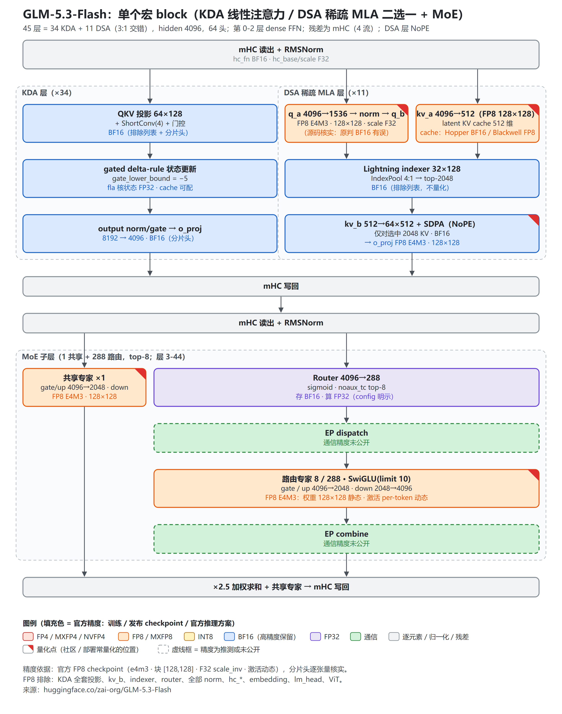
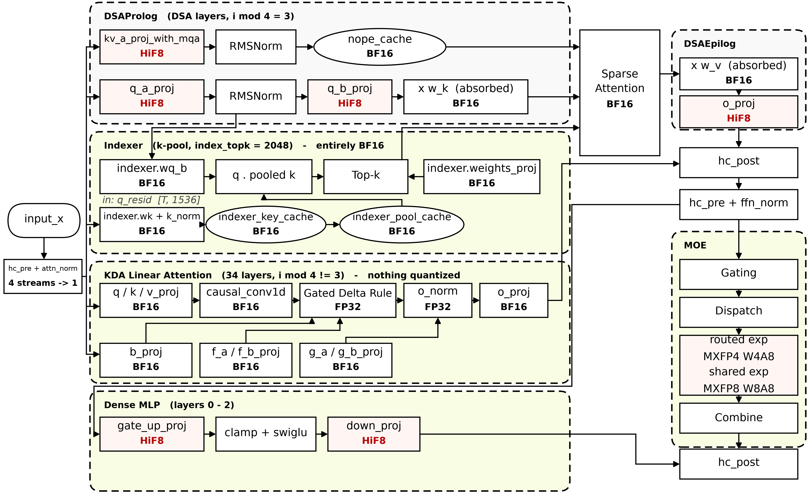

# GLM-5.3-Flash CANN 优化实践

## 引言

GLM-5.3-Flash 是智谱发布的混合注意力 + mHC + MoE 大模型，骨干约 306B 参数，默认以 FP8 量化格式发布。结构上有三处和常规 MoE 不同：45 层中 34 层用 KDA（Kimi Delta Attention）线性注意力，每 4 层插入 1 层 MLA + DSA 稀疏注意力；层间残差用 mHC 扩展为 4 路并行流。

CANN 完成了该模型在昇腾 950DT 上的推理适配，采用 Hybrid HiF8-MXFP8-MXFP4 混合量化，8 卡 EP 部署。本次适配的主要工作是混合注意力的昇腾实现（KDA 的 ShortConv 与门控 delta 递推、DSA 的吸收式 MLA 与 k-pool indexer）、mHC 的 AscendC 融合算子，以及面向 950 的量化方案。

部署步骤详情可见 [models/glm_5_3/README.md](../../../models/glm_5_3/README.md)。

## Outline

- [模型结构](#模型结构)
- [量化策略](#量化策略)
- [融合算子与多流](#融合算子与多流)
- [推理部署](#推理部署)
- [实测数据](#实测数据)
- [后续工作](#后续工作)

## 模型结构

### 总体架构

主干 45 层，每层由 mHC、Attention、FFN 三部分组成，层间隐藏态是 `hc_mult = 4` 路并行残差流 `[T, 4, D]`。主要配置：

| 项 | 取值 |
|---|---|
| `num_hidden_layers` | 45 |
| `hidden_size` / `intermediate_size` / `moe_intermediate_size` | 4096 / 12288 / 2048 |
| `max_position_embeddings` | 1048576 |
| 注意力层排布 | `i % 4 != 3` 为 KDA（34 层），`i % 4 == 3` 为 DSA（11 层） |
| MLA | `q_lora_rank=1536`，`kv_lora_rank=512`，`qk_nope_head_dim=256`，`v_head_dim=256`，`qk_rope_head_dim=0` |
| Indexer | `index_n_heads=32`，`index_head_dim=128`，`index_topk=2048`，`index_kpool=4` |
| KDA | `num_heads=64`，`head_dim=128`，`short_conv_kernel_size=4`，`gate_lower_bound=-5.0` |
| MoE | 288 路由专家 top-8 + 1 共享专家，`first_k_dense_replace=3`，sigmoid + noaux_tc，`routed_scaling_factor=2.5` |
| mHC | `hc_mult=4`，`hc_sinkhorn_iters=20` |

单个宏 block 的结构如下图。图中填充色表示官方发布权重的精度，可与下文的量化划分对照。

<p align="center">
  
</p>

单层前向顺序：

```
hc_pre -> input_layernorm -> Attention(KDA 或 DSA) -> hc_post
       -> hc_pre -> post_attention_layernorm -> FFN(Dense MLP 或 MoE) -> hc_post
```

### KDA 层（34 层）

KDA 用 ShortConv 加门控 delta 递推替代 softmax attention，不写 KV Cache。主路径为 `q_proj / k_proj / v_proj` → ShortConv → 门控 delta 递推 → `o_norm` → `o_proj`，另有三条旁路：`b_proj` 产生递推的写入强度，`f_a_proj → f_b_proj` 产生衰减，`g_a_proj → g_b_proj` 产生输出门送入 `o_norm`。递推的状态量 `a_log`、`dt_bias` 与 `o_norm` 保持 FP32。

### DSA 层（11 层）

DSA 是吸收式 MLA，并且不做位置编码（NoPE）：`qk_rope_head_dim` 为 0，Q、K 都不经过 RoPE，indexer 侧同样没有位置编码，序列顺序信息由 KDA 层承载。稀疏注意力算子要求传入 `query_rope` / `key_rope`，实现上用全零张量占位。Q 路为 `q_a_proj` → `q_a_layernorm` → `q_b_proj`，KV 路为 `kv_a_proj_with_mqa` → `kv_a_layernorm` → 写入 latent KV Cache。`kv_b_proj` 在加载时拆成 `w_k` 与 `w_v`，分别吸收进 Q 侧和输出侧，不作为独立 matmul 出现，attention 直接在 512 维 latent 上计算。

Indexer 为稀疏注意力挑选 top-2048 的 KV，有 `wq_b`、`wk`、`weights_proj` 三个投影，并维护 key、gate 两个 cache 以及按 `index_kpool=4` 聚合的 pool cache。pool cache 使用独立的 block 管理，压缩比 4。

### mHC

mHC 把单路残差扩展为 4 路。`hc_fn` 作用在归一化后的隐藏态上，一次产出三组系数：折叠权重 `pre`、写回权重 `post`（两者都经 sigmoid）和 4×4 的残差混合矩阵 `comb`（经 softmax 后再做 20 次 Sinkhorn 行列交替归一化）。子层前，`hc_pre` 用 `pre` 对 4 路加权求和，折叠成 1 路送进子层；子层后，`hc_post` 用 `post` 把子层输出写回每一路，再叠加 `comb` 对原始 4 路残差流的混合。两个方向各融合为一个 AscendC 算子（`npu_hc_pre` / `npu_hc_post`），相关参数全部保持 FP32。

### MoE

层 0–2 为稠密 MLP，层 3–44 为 MoE。每个 MoE 块有 288 个路由专家（top-8，sigmoid 打分，noaux_tc）和 1 个共享专家，SwiGLU 带 `swiglu_limit=10` 的 clamp。路由门用 FP32 计算。

## 量化策略

### 官方发布权重的量化格式

[GLM-5.3-Flash](https://huggingface.co/zai-org/GLM-5.3-Flash) 默认仓库是 block-wise FP8：权重为 `float8_e4m3fn`，每 128×128 块共享一个 FP32 scale，激活为 per-token 动态量化。
FP8 覆盖 DSA 层的 `q_a_proj` / `q_b_proj` / `kv_a_proj_with_mqa` / `o_proj`、稠密 MLP、共享专家和路由专家；排除 KDA 层全套投影、`kv_b_proj`、整个 indexer、路由门、全部 norm、mHC 参数、embedding、`lm_head` 和 ViT。

### 本实践的量化划分

| 格式 | 作用对象 | 粒度 |
|---|---|---|
| HiF8 W8A8 | DSA 的 `q_a_proj` / `q_b_proj` / `kv_a_proj_with_mqa` / `o_proj`；稠密 MLP | 权重 PerChannel 量化，激活值 PerTensor 静态量化 |
| MXFP8 W8A8 | 共享专家 | 权重与激活均每 32 元素一组，E8M0 scale |
| MXFP4 W4A8 | 路由专家 | 权重 MXFP4 每 32 元素一组，激活 MXFP8 |

量化边界见下图，粉色框为被量化的模块，白色框保持 BF16 或 FP32。

<p align="center">
  
</p>

保持 BF16 或 FP32 的部分包括：KDA 34 层的全套投影（`q/k/v_proj`、`o_proj`、`b_proj`、`f_a/f_b_proj`、`g_a/g_b_proj`）、`kv_b_proj`、indexer 的三个投影、路由门、mHC 参数、KDA 递推的状态量、各 RMSNorm、embedding 与 `lm_head`。


## 融合算子与多流

本实践使用的自定义算子：

| 算子 | 用途 |
|---|---|
| `npu_hc_pre` / `npu_hc_post` | mHC 的折叠与展开 |
| `causal_conv1d_fn` / `causal_conv1d_update` | KDA ShortConv，分别用于 prefill 与 decode |
| `swiglu_group_quant` | 共享专家 MXFP8 路径下融合 SwiGLU 与 MX 激活量化 |

稀疏注意力使用 `torch_npu.npu_sparse_flash_attention`，按 `TND` / `PA_BSND` 布局在 latent 上计算。

共享专家的输入不依赖路由结果，decode 阶段放在侧流上执行，与路由专家的 dispatch、GMM、combine 重叠，默认开启。

## 推理部署

8 卡部署，`moe_tp_size` 为 1，框架据此派生 `moe_ep_size = world_size`，路由专家按 Expert 维切分；attention 与稠密层走 DP，并行度全部来自 MoE EP。CP 以及 attention、dense、o_proj、shared 的 TP 当前都要求为 1。
运行环境为昇腾 950DT，CANN 9.2.0 版本，推理支持 `npugraph_ex` 图模式。

## 实测数据

### 精度

下表是 Hybrid HiF8-MXFP8-MXFP4 与 BF16 baseline 的对比，覆盖数学、科学问答、长文本、中英文知识和代码五类任务。各项指标为准确率，单位 %。

| Benchmark | baseline (%) | Hybrid HiF8-MXFP8-MXFP4 (%) | 差值（百分点） |
|---|---:|---:|---:|
| Math500 | 95.7 | 95.7 | 0 |
| GPQA | 80.0 | 81.0 | +1.0 |
| LongBench v2 | 57.9 | 57.1 | -0.8 |
| CMMLU | 91.2 | 91.2 | 0 |
| MMLU Pro | 85.4 | 85.5 | +0.1 |
| HumanEval+ | 94.7 | 94.1 | -0.6 |
| LiveCodeBench V6 | 72.9 | 72.5 | -0.4 |

差值为量化方案减 baseline，正值表示提升。7 项平均 -0.1 个百分点，Math500 与 CMMLU 持平，各项变化都在 1 个百分点以内。

### 性能

下表是 decode 阶段的吞吐实测，固定输入长度按每卡 batch size 扫描。测试条件为 Ascend 950DT、8 卡 EP、8K 输入序列、`npugraph_ex` 图模式：

| 每卡 BS | Decode 每步耗时 (ms) | 每卡 TPS | 8 卡总 TPS |
|--------|-------------------|---------|---------|
| 1 | 16.60 | 60.24 | 481.93 |
| 16 | 24.07 | 664.73 | 5317.82 |
| 64 | 35.69 | 1793.22 | 14345.76 |
| 128 | 49.88 | 2566.16 | 20529.27 |

## 后续工作

当前量化只覆盖 Linear 权重，DSA 侧的 Indexer 与 Sparse Attention 两个计算主体以及它们读写的 cache 仍为 BF16，对应的算子需求如下：

| 算子名称 | 精度是否达标 | HiF8 | HiF4 | 性能预期收益 | 训练 or 推理 | 优先级 |
|---|:---:|:---:|:---:|---|---|:---:|
| GLM Indexer | 是 | Yes | Yes | 预期整网端到端 4-5% | 训练 & 推理 | 0 |
| GLM Indexer 反向 | 是 | Yes | Yes | 预期整网端到端 4-5% | 训练 | 0 |
| GLM Sparse Attention | 是 | Yes | | 与序列长度有关，序列越长收益越大 | 训练 & 推理 | 1 |
| GLM Sparse Attention 反向 | 是 | Yes | | 与序列长度有关，序列越长收益越大 | 训练 | 1 |
