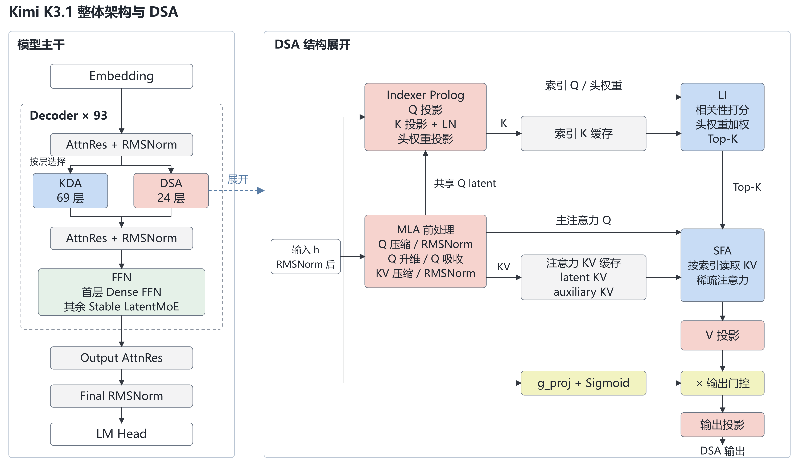
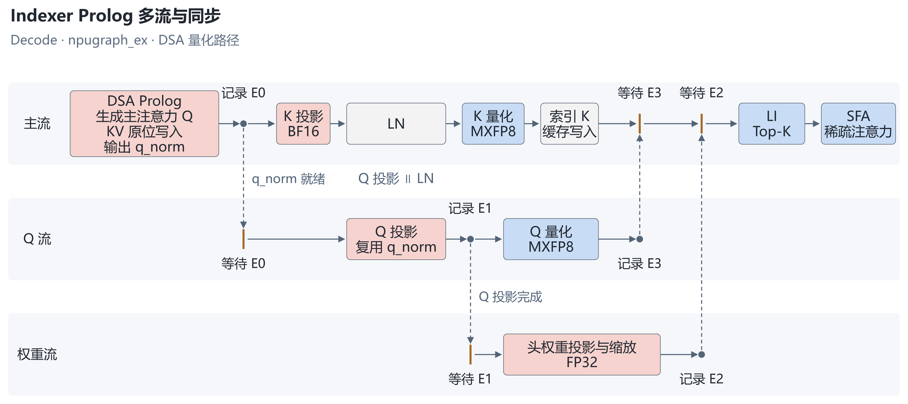
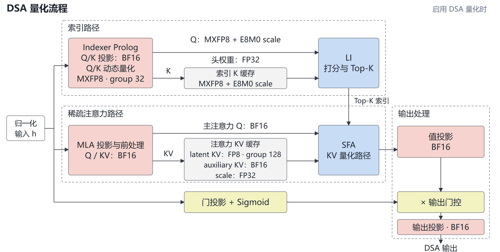
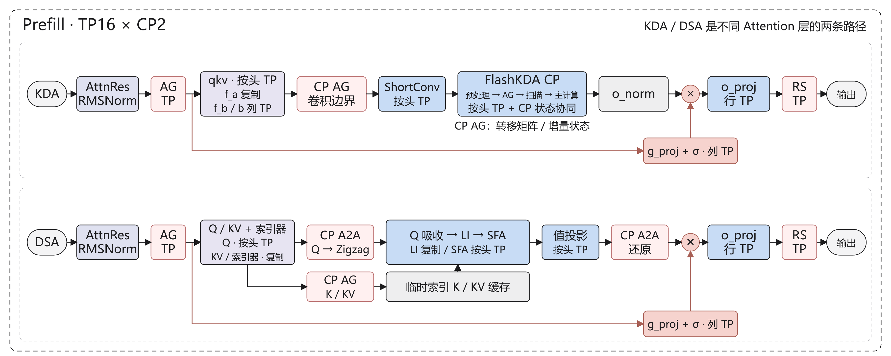
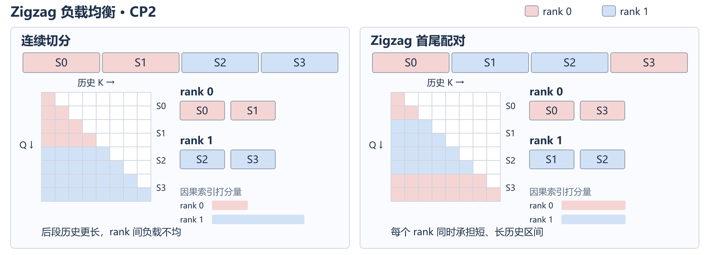
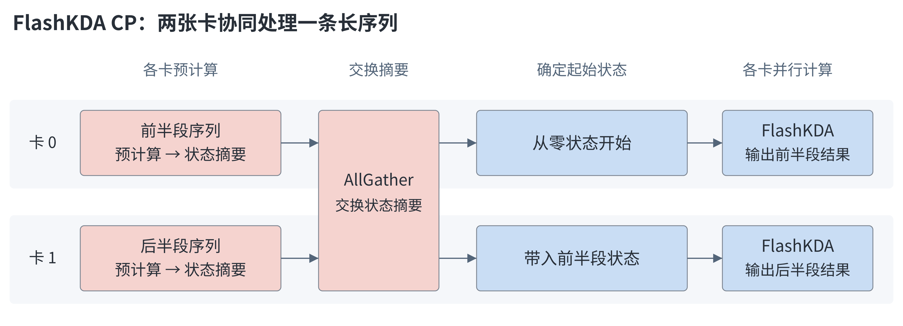

# Kimi K3.1 昇腾 NPU 推理优化实践

Kimi K3.1 在 K3 的混合注意力主干上接入 DSA，并支持 Prefill CP。本文介绍 DSA 的融合计算、多流与量化，以及长序列 Prefill CP 优化。

完整运行方法见[模型 README](../../../models/kimi_k3_1/README.md)。

## Outline

- [概述与优化亮点](#概述与优化亮点)
- [模型架构与 DSA 数据流](#模型架构与-dsa-数据流)
- [融合Kernel](#融合kernel)
- [Indexer 输入准备与多流编排](#indexer-输入准备与多流编排)
- [量化策略](#量化策略)
- [Prefill CP](#prefill-cp)
- [性能](#性能)

## 概述与优化亮点

长上下文推理需要同时控制注意力计算量、KV 访存和 Prefill 的单 rank 中间张量占用。K3.1 的实现围绕这三类开销组织计算：DSA 先选择历史位置，再读取对应 KV；Prefill CP 将一个请求的 token 分到多个 CP rank，分别处理 DSA 的因果负载与 KDA 的递推状态依赖。

- **DSA 融合计算**：LI 融合索引打分、加权规约和 Top-K，SFA 根据索引在压缩 KV 空间完成注意力计算；Decode Prolog 原位写入主注意力 KV，并返回 `q_norm` 供 Indexer 复用。
- **Indexer 多流**：Decode 的 npugraph_ex 路径使用主流、Q 流和头权重流，在事件依赖下并行准备 LI 输入。Q 投影与 K 分支 LN 之间没有数据依赖。
- **低精度缓存**：索引 Q/K 使用 MXFP8，主注意力 latent KV 使用分组 FP8；auxiliary KV 保留 BF16。CP 在通信前完成相应量化。
- **Prefill CP**：DSA 用 K/KV AllGather 与 Q Zigzag 交换平衡因果索引计算；KDA 用卷积边界交换和状态摘要前缀扫描保持连续序列语义。Prefill 结束后按 Decode 请求归属保留常驻状态。

共用设计见 K3 文档中的 [AttnRes](./kimi_k3_inference_guide.md#attention-residuals)、[KDA](./kimi_k3_inference_guide.md#kimi-delta-attention)、[Stable LatentMoE](./kimi_k3_inference_guide.md#stable-latentmoe)、[DSpark](./kimi_k3_inference_guide.md#dspark-投机推理)与 [npugraph_ex 图模式](./kimi_k3_inference_guide.md#npugraph_ex-图模式)。

## 模型架构与 DSA 数据流

Kimi K3.1 交错使用 KDA 与 DSA：KDA 通过状态递推处理序列；DSA 在 MLA 基础上引入索引选择，由 LI 筛选 Top-K 历史位置，再由 SFA 读取对应 KV 完成稀疏注意力计算。模型继续通过 AttnRes 聚合跨层表示。

  

## 融合Kernel

DSA 接入 MLAProlog、Lightning Indexer 和 Sparse Flash Attention 融合算子。

- **Lightning Indexer**：融合 QK 打分、ReLU、头权重加权、ReduceSum 和 Top-K。通过 Cube/Vector 流水重叠矩阵乘与 Top-K 计算，减少中间数据搬运和串行等待。
- **Sparse Flash Attention**：按 Top-K 索引从 KVCache 读取相关 token，在 latent 空间完成稀疏注意力计算；通过访存与计算流水，减少离散 KV 读取带来的等待。
- **MLAProlog**：在 Decode 阶段融合 Q/KV 投影、Norm 和主注意力 KV 原位写入，并返回 `q_norm` 供 Indexer 复用。K3.1 采用 NoPE，不执行 RoPE。

LI 与 SFA 的算子实现在 [CANN/ops-transformer](https://gitcode.com/cann/ops-transformer) 开源，包括 [lightning_indexer](https://gitcode.com/cann/ops-transformer/tree/master/attention/lightning_indexer)、[quant_lightning_indexer](https://gitcode.com/cann/ops-transformer/tree/master/attention/quant_lightning_indexer)、[sparse_flash_attention](https://gitcode.com/cann/ops-transformer/tree/master/attention/sparse_flash_attention) 和 [kv_quant_sparse_flash_attention](https://gitcode.com/cann/ops-transformer/tree/master/attention/kv_quant_sparse_flash_attention)。

## Indexer 输入准备与多流编排

Indexer 通过主流、Q 流和头权重流协同准备 LI 输入，使 Q 投影与 K 归一化、Q 量化与头权重投影具备并行执行机会，减少输入准备阶段的串行等待。各分支通过事件同步，在 LI 计算前汇合。

  

该编排用于 NPU Decode 的 `npugraph_ex` 模式，由 `enable_multi_streams` 开启。实现见 [Indexer 输入准备](../../../models/kimi_k3_1/models/modeling_kimi_k3.py#L3617)。

## 量化策略

DSA 保留 BF16 投影计算，对索引 Q/K 和 KVCache 分层量化，降低存储与访存开销。LI 的索引 Q/K 采用 MXFP8 动态 per-group 量化，每 32 个元素共享一个缩放因子；SFA 的 latent KV 采用 FP8 per-token-head-tile 量化，每个 token、每个 head 内按 128 个元素分块。辅助 Key 仅参与注意力打分，按当前 SFA 接口保留 BF16。

  

## Prefill CP

Prefill 支持 CP × TP 组合部署，沿序列维度切分长输入，并结合 TP 组内的序列并行，降低单卡激活与中间张量占用。

  

DSA 的因果索引计算存在“序列越靠后、可见历史越长”的负载差异。Zigzag 将首尾配对的两段序列分配到同一卡，平衡跨卡索引计算量，完成计算后恢复原有顺序。

  

### FlashKDA CP

仅用 TP 按注意力头切分时，每张卡仍需处理完整序列。FlashKDA CP 进一步沿序列维度切分输入，将长序列计算分摊到多张卡，以降低 Prefill 计算耗时和单卡中间张量占用。

基于 CANNBot-DSL，各卡先并行预计算，通过 AllGather 交换状态摘要，再按序合成前序分片的状态贡献，得到各自的起始状态，随后并行完成本段计算。

  

## 性能

结合 DSA 稀疏注意力与 DSpark 投机推理，Kimi K3.1 的等效 Decode 时延低于 **10 ms/token**。测试条件为昇腾 950、32 卡、输入 100K、Global Batch 32、CP1，DSpark 接受长度统一按 4 折算，仅统计主模型与 DSpark 耗时。

| 主模型 | DSpark | 单轮合计 | 等效 Decode 时延（合计 ÷ 4） |
|---:|---:|---:|---:|
| 36.44 ms | 3.44 ms | 39.88 ms | **9.97 ms/token** |
