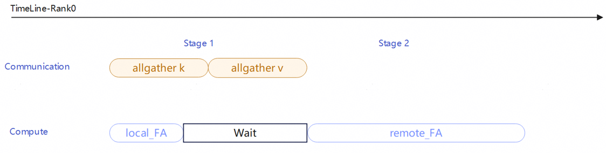

## NPU Wan2.2-I2V模型推理优化实践

本文档主要介绍Wan2.2-I2V模型基于NPU的推理优化策略和实现。
###  NPU npu_fused_infer_attention_score算子适配
首先需要`import torch_npu`以及相关package，在`generate.py`(L30)后加上：
```
import torch_npu
torch_npu.npu.set_compile_mode(jit_compile=False)
torch.npu.config.allow_internal_format=False
from torch_npu.contrib import transfer_to_npu
```
本样例使用torch_npu内置的npu_fused_infer_attention_score融合算子替代FlashAttention算子，该算子详细可见[Ascend社区文档](https://www.hiascend.com/document/detail/zh/Pytorch/720/apiref/torchnpuCustomsapi/context/torch_npu-npu_fused_infer_attention_score.md)。在`wan/modules/attention.py`(L69)的npu_fused_attention函数中，使能fused_infer_attention_score算子：
```
    attention_out, _ = torch_npu.npu_fused_infer_attention_score(
        q, k, v,
        actual_seq_lengths=actual_seq_lengths,
        actual_seq_lengths_kv=actual_seq_lengths_kv,
        num_heads=N,
        scale=float(softmax_scale),
        input_layout="BNSD",
        num_key_value_heads=num_key_value_heads,
        pre_tokens=65535,
        next_tokens=65535 if not causal else 0,
        sparse_mode=0,
        inner_precise=0,
    )

    attention_out = attention_out.transpose(1, 2).contiguous()
    return attention_out.to(out_dtype)
```


###  NPU rotary_mul算子适配
本样例使用torch_npu内置的npu_rotary_mul融合算子替换源代码中的小算子实现，npu_rotary_mul详细可见[Ascend社区文档](https://www.hiascend.com/document/detail/zh/Pytorch/710/apiref/torchnpuCustomsapi/context/torch_npu-npu_rotary_mul.md)。在`/wan/modules/model.py`(L58)的rope_apply函数中，使能npu_rotary_mul融合算子：
```
@torch.amp.autocast('cuda', enabled=False)
def rope_apply(x, grid_sizes, freqs_list):
    s, n, c = x.size(1), x.size(2), x.size(3)
    output = []
    for i, (f, h, w) in enumerate(grid_sizes.tolist()):
        x_i = x[i, :s].reshape(1, s, n, c)
        if not x_i.is_contiguous():
            x_i=x_i.contiguous()

        cos, sin = freqs_list[i]

        if cos.dim() == 3:
            cos = cos.unsqueeze(0)
            sin = sin.unsqueeze(0)

        cos = cos.to(dtype=x_i.dtype, device=x_i.device)
        sin = sin.to(dtype=x_i.dtype, device=x_i.device)

        x_i = torch_npu.npu_rotary_mul(
            input=x_i,
            r1=cos,
            r2=sin,
            rotary_mode="interleave"
        )

        output.append(x_i)
```

###  NPU rms_norm算子适配
本样例使用torch_npu内置的npu_rms_norm融合算子替换源代码中的小算子实现。npu_rms_norm详细可见[Ascend社区文档](https://www.hiascend.com/document/detail/zh/Pytorch/710/apiref/torchnpuCustomsapi/context/%EF%BC%88beta%EF%BC%89torch_npu-npu_rms_norm.md)。

在`/wan/modules/model.py`(L87)的WanRMSNorm.forward中使能了npu_rms_norm融合算子：
```
class WanRMSNorm(nn.Module):

    def __init__(self, dim, eps=1e-5):
        super().__init__()
        self.dim = dim
        self.eps = eps
        self.weight = nn.Parameter(torch.ones(dim))

    def forward(self, x):
        r"""
        Args:
            x(Tensor): Shape [B, L, C]
        """
        return torch_npu.npu_rms_norm(x, self.weight, epsilon=self.eps)[0]
```
###  NPU layer_norm_eval算子适配

本样例使用torch_npu内置的npu_layer_norm_eval融合算子替换源代码中的小算子实现。npu_layer_norm_eval详细可见[Ascend社区文档](https://www.hiascend.com/document/detail/zh/Pytorch/710/apiref/torchnpuCustomsapi/context/%EF%BC%88beta%EF%BC%89torch_npu-npu_layer_norm_eval.md)。

在`/wan/modules/model.py`(L103)的WanLayerNorm.forward中使能了npu_layer_norm_eval融合算子：
```
class WanLayerNorm(nn.LayerNorm):

    def __init__(self, dim, eps=1e-6, elementwise_affine=False):
        super().__init__(dim, elementwise_affine=elementwise_affine, eps=eps)
        self.dim = dim

    def forward(self, x):
        r"""
        Args:
            x(Tensor): Shape [B, L, C]
        """
        return torch_npu.npu_layer_norm_eval(
            x, normalized_shape=[self.dim], weight=self.weight, bias=self.bias, eps=self.eps
        )
```
另外，本样例对部分layer norm(LN)和modulate操作进行了融合，同样使用npu_layer_norm_eval融合算子，在`/wan/modules/model.py`(L119)的FusedLayerNormModulate.forward中使能了相关融合操作：
```
class FusedLayerNormModulate(nn.Module):

    def __init__(self, dim, eps=1e-6):
        super().__init__()
        self.dim = dim
        self.eps = eps

    def forward(self, x, scale, shift):
        r"""
        Args:
            x(Tensor)
        """
        weight = 1.0 + scale
        bias = shift
        return torch_npu.npu_layer_norm_eval(
            x, normalized_shape=[self.dim], weight=weight, bias=bias, eps=self.eps
        )
```
模型每个block内有4个LN操作，其中3个LN操作的gemma和beta都是固定的初始1和0，那么通过(x-mean)/var*1+0)*(scale+1)+shift，调用NPU融合算子npu_layer_norm_eval将3个LN和对应的modulate步骤融合。

###  8卡VAE并行
本样例对模型的VAE并行进行了使能。通过空间并行的方式实现，将大尺寸图像在高度和宽度维度上切分成多个块，分配给不同的NPU进程并行处理，可以加速原模型VAE推理。在`wan/vae_patch_parallel.py`脚本实现此优化。

以下VAE并行流程图展示了空间并行处理的完整执行路径：


1. 首先将输入张量按空间维度切分到多个进程，每个进程处理自己的局部块；
2. 然后在计算过程中根据不同操作的特点采用相应的通信策略——卷积操作通过与邻居交换边界数据来获取上下文，注意力操作通过全局收集所有K,V张量来保证计算完整性，插值操作通过扩展边界、计算后再裁剪来处理上采样；
3. 最后通过两阶段的收集过程将各个进程的局部结果按照原始的空间位置重新拼接成完整的输出张量。

###  CFG并行
本样例对模型的CFG并行进行了使能。在`/wan/iamge2video.py`(L432)实现：
```
for step_idx, t in enumerate(tqdm(timesteps)):
    latent_model_input = [latent.to(self.device)]
    timestep = [t]
    timestep = torch.stack(timestep).to(self.device)

    model = self._prepare_model_for_timestep(t, boundary, offload_model)
    sample_guide_scale = guide_scale[1] if t.item() >= boundary else guide_scale[0]

    extra_kwargs = {'t_idx': step_idx} if hasattr(self, 'use_sp') and self.use_sp else {}

    if get_classifier_free_guidance_world_size() == 2:
        noise_pred = model(
            latent_model_input, t=timestep, **arg_all, **extra_kwargs)[0].to(
                torch.device('cpu') if offload_model else self.device)
        noise_pred_cond, noise_pred_uncond = get_cfg_group().all_gather(
            noise_pred, separate_tensors=True
        )
        if offload_model:
            torch.cuda.empty_cache()
    else:
        noise_pred_cond = model(
            latent_model_input, t=timestep, **arg_c, **extra_kwargs)[0]
        if offload_model:
            torch.cuda.empty_cache()
        noise_pred_uncond = model(
            latent_model_input, t=timestep, **arg_null, **extra_kwargs)[0]
        if offload_model:
            torch.cuda.empty_cache()

    noise_pred = noise_pred_uncond + sample_guide_scale * (
        noise_pred_cond - noise_pred_uncond)
```

当检测到CFG并行环境时，它会将条件生成和无条件生成这两个任务分配到两个不同的进程上同时执行，每个进程只需要运行一次模型推理，然后通过all_gather通信操作让两个进程互相获取对方的计算结果，最后使用CFG公式将条件预测和无条件预测按照引导系数混合，得到最终的噪声预测结果，如果没有启用并行环境则会退化到传统模式顺序执行两次模型推理。


###  Ring Attention Overlap

在多卡Ring Attention中，通过异步启动AllGather收集其他卡的KV数据，同时立即使用本地KV计算第一个FA，让NPU计算与网络通信并行执行以掩盖通信延迟；待AllGather完成后，将其他多个远程chunks合并为一个长序列一次性计算第二个FA，最后用LSE（Log-Sum-Exp）算法正确合并两次attention输出，[达成将通信时间隐藏在本地计算中](https://gitcode.com/cann/cann-recipes-infer/blob/master/module/unified_sp/core.py)。


=======
### Dit-Cache

DIT-Cache作为扩散模型推理加速的缓存框架，通过复用/预测已有的结果，减少冗余前向计算。其加速逻辑可清晰的分为Step-level和Block-level范式，Step-level通过判断不同采样步数step间的特定特征差异，通过阈值比较，决定是否跳过完整的step计算，直接复用或者预测缓存结果；Block-level以block为粒度（通常是attention模块和mlp模块）判断是否直接复用或者预测缓存结果。

本样例集成了Step-level的Dit-Cache方案，支持 [FBCache](https://github.com/chengzeyi/ParaAttention)、[TeaCache](https://liewfeng.github.io/TeaCache/) 和 [TaylorSeer](#taylorseer)。


**Step-level典型方法：** 在Step-level加速范畴内，[FBCache](https://arxiv.org/pdf/2411.19108)的原理是基于First Block L1误差，比较第一个Block输出残差与上一步的第一个Block输出残差之间的差异，如果首块输出误差与上一轮首块输出误差差异小于指定阈值，就跳过当前步计算，复用残差，对当前步的输出进行估计。

[TeaCache](https://liewfeng.github.io/TeaCache/) 利用模型输入与输出的强相关性，通过Timestep Emebdding（输入）来估计输出差异：先利用该输入粗估输出变化，再通过多项式拟合修正缩放偏差，最终以累积差异作为判断标准，动态决定是否复用上一步被Cache的输出，避免冗余计算。由于WAN2.2具有CFG串行的特点，因此本项目采用teacache官方实现的cond/uncond分别管理的 [TeaCache](https://github.com/ali-vilab/TeaCache/tree/main/TeaCache4Wan2.1)。在本代码中详情见[`module/dit_cache/cache_method.py`](../../../module/dit_cache/cache_method.py)。

**启动方式：** Dit-Cache 配置已收敛到启动 YAML 的 `dit_cache` 段。单卡启用 Dit-Cache 时，将 `infer.sh` 中的 `YAML_FILE_NAME` 设置为`14b_single.yaml`，然后通过 `dit_cache.method` 选择 `FBCache` 或 `TeaCache`。当前 wan2.2-i2v 多卡路径与 Dit-Cache 不兼容，`world_size` > 1 时框架会自动回退到 NoCache 并打印提示。

以 TeaCache 为例：
```yaml
dit_cache:
  method: "TeaCache"                # NoCache / FBCache / TeaCache
  enable_separate_cfg: true         # CFG 分离开关，true 时 cond/uncond 各自维护缓存状态
  params:                           # 仅填写需覆盖的参数；其余沿用 DEFAULT_CACHE_CONFIG
    rel_l1_thresh: 0.15              # 示例覆盖值；内置默认值 0.15，越大缓存复用越多、精度损失越大
    coefficients: [733.226126, -401.131952, 67.5869174, -3.149879, 0.0961237896]
    warmup: 2                       # 前 N 步与最后 N 步强制完整计算，不进行缓存判定
```

infer.sh 配置示例：
```bash
export YAML_FILE_NAME=14b_single.yaml
```

`mm_function.sh` 在拉起时会将该 YAML 作为 `--cache_config` 路径传给 `generate.py`，由 `module/dit_cache/cache_method.py` 的 `load_cache_config()` 解析 `dit_cache` 段并合并内置默认值。各方法完整默认值见 `module/dit_cache/cache_method.py:DEFAULT_CACHE_CONFIG`，也可参考 [多模态推理统一拉起设计](../../design/mm_inference_design.md) §5。

- **框架位置：** 使用 `module/dit_cache/` 作为自定义库，在模型 forward 处导入，具体如下：
```
    cann-recipes-infer
        +--- models                            # 模型目录
        |   +--- wan2.2-i2v
        |       +--- infer.sh                  # 统一入口
        |       +--- config                    # 启动 YAML，含 dit_cache 段
        |       +--- wan
        |           +--- cache                 # cache 适配模型接口
        |               +--- cache_block.py    # Dit-Cache 适配双流模块
        +--- module
            +--- dit_cache                     # step-level 缓存实现
                +--- cache_method.py           # CacheManager / FBCache / TeaCache / TaylorSeer / NoCache
```

### TaylorSeer

TaylorSeer 利用相邻去噪步的组残差及其有限差分预测特征，减少完整 DiT 计算。Host Offload 将缓存因子保存在 CPU 内存。异步 Prefetch 提前搬入下一组因子，使传输有机会与当前组计算重叠。

当前支持 Atlas A3 单卡、BF16 `i2v-A14B` 双专家、batch 1 和串行请求。缓存因子为连续的 `[B,S,C_hidden]` FP32 张量，模型计算保持 BF16。使用方法见[模型 README](../../../models/wan2.2-i2v/README.md#四档复现)。

#### 组残差预测

每个专家的连续 block 按 `cache_group_size` 分组。完整计算（full）步执行原 block，保存组残差 `F = float32(x_out) - float32(x_in)`；预测（predict）步在组首将预测残差加回输入，跳过同组剩余 block，后续组、输出 head、CFG 和 scheduler 继续执行。

若相邻 full 步间隔为 Δ，因子按有限差分更新：`D_new[0] = F`，`D_new[r] = (D_new[r-1] - D_prev[r-1]) / Δ`。距最近 full 步 h 步时，预测残差为 `Σ D[r] * h^r / r!`。首次 full 初始化零阶，历史不足时只使用已有阶数；预测结果不进入导数历史。

以当前专家的局部步数 k、全请求步数 s、总步数 T 表示，以下任一条件触发 full：

- `k < warmup`；
- `(k - warmup) % skip_interval_steps == 0`；
- `s >= T - cutoff_steps`；
- 新专家激活，或所需组/CFG 缺少历史。

每次专家切换从 k=0 重新建立历史；请求、专家、CFG 分支及 block 组之间的缓存独立。下述 A3 场景在 high 15 步、low 25 步的固定 40 步调度中执行 15 个 full 步和 25 个 predict 步。CFG 双分支不重复计为 scheduler 步数。

#### Host Offload

关闭缓存 offload 时，当前专家的因子常驻 NPU；开启后，完整因子保存在普通 Host 内存，通过有限数量的 pinned buffer 搬运：

1. 计算流产生新因子后记录事件，D2H 流等待事件并将因子拷入一个 pinned staging buffer。
2. Host writer 等待 D2H 完成，将数据复制到普通 Host 缓存后发布新 generation。发布完成前不允许复用 staging 或提交下一份更新。
3. 读取历史时，将 Host 因子经 pinned staging 搬入 NPU slot。H2D/D2H 使用 `Tensor.copy_(..., non_blocking=True)`，计算流等待对应的完成事件后使用数据。
4. 消费结束记录 `last_use` 事件，slot 再次写入前等待该事件。专家切换、请求结束及异常路径均清理缓存和在途传输。

设单份 FP32 特征大小为 `b = 4 * B * S * C_hidden`，最高阶为 q，组数为 G，单组因子大小上限为 `U = (q+1)*b`，双 CFG 因子总量为 `C = 2*G*U`：

| 缓存路径 | 普通 Host 预算 | pinned 预算 | NPU 缓存及 scratch 预算 |
| --- | --- | --- | --- |
| 因子常驻 NPU | 0 | 0 | `C + U + 4b` |
| Host Offload | `C + U` | `3U` | `3U + 4b` |

预算为 `null` 时按实际形状计算有限上限，显式上限不足时直接报错。模型权重、激活、VAE/T5、其他 workspace 和 allocator reserved 容量需要另外预留。

#### 异步 Prefetch

开启 `prefetch` 后，当前组计算入队时提前加载同一专家、同一 CFG 分支的下一组已发布因子。两个 H2D/NPU slot 交替使用，消费流通过 `h2d_ready` 等待所需 generation，避免读取尚未完成的传输。未命中预取时按需加载；关闭 prefetch 后所有因子均按需加载。

预取距离固定为一组，不跨专家或 CFG 分支。实际收益取决于计算窗口和传输耗时，预测计算过短时无法完全隐藏拷贝。可通过 `WanTaylor/PrefetchH2D`、`DemandH2D`、`AcquireWait` 等 profiler 范围检查搬算重叠及消费等待。

#### 性能与内存结果

以下为 Atlas A3、CANN 8.5.0、PyTorch 2.7.1、torch_npu 2.7.1.post2 下的固定五场景测试：`blackswan`、`breakdance`、`bmx-trees`、`car-roundabout`、`horsejump-high`。使用 `size=640*360`、61 帧、40 步、seed=100，实际输出为 `[3,61,352,640]`；四档均开启模型 offload 和 `reuse_offload_memory`，三个 Taylor 档均采用 q=1、K=5、w=3、c=2、g=20。

每个场景先取三次正式生成的均值，再对五个场景等权平均，保留全部慢样本。降时按 `1 - 当前档均值 / B0均值` 计算；NPU peak allocated 为各档 15 次正式请求中，框架统计的最大分配峰值。

| 档位 | 组合 | 平均时延（s） | 相对 B0 降时 | NPU peak allocated（GiB） |
| --- | --- | ---: | ---: | ---: |
| B0 | NoCache | 226.391 | — | 30.676 |
| B1 | TaylorSeer | 103.867 | 54.121% | 33.093 |
| B2 | TaylorSeer + Host Offload | 118.679 | 47.578% | 32.019 |
| B3 | TaylorSeer + Host Offload + Prefetch | 112.504 | 50.305% | 32.019 |

本批次中，Host Offload 将 NPU 分配峰值从 33.093 GiB 降至 32.019 GiB，同时增加了传输开销。B3 的平均时延比 B2 低 6.175 s。实际搬算重叠可结合上文的 profiler 范围观察。端到端计时从模型加载后开始，到生成结束并完成设备同步为止，覆盖生成、缓存与模型搬运及清理。

### W8A8 量化

两个 DiT 噪声专家在加载阶段将 Attention 的 q/k/v/o 和 FFN 两层投影替换为 W8A8 Linear，复用仓内 `CompressedTensorsW8A8Int8LinearMethod.apply_weights` 执行动态量化与矩阵乘。Head、时间/文本嵌入、Norm、RoPE、Attention kernel、残差及 T5/VAE 沿用原有计算路径。

权重使用对称、按输出通道的 INT8 量化；每个通道的 FP32 scale 由绝对最大值除以 127 得到，经过 round-to-even 和 [-127,127] 截断。全零通道保持零权重并使用 scale=1。激活在 NPU 上按 token 动态量化，矩阵乘融合原始 BF16 bias 并输出 BF16。

需要保留浮点精度的投影通过 ignored 层名单保存原始 BF16 权重。运行时仅替换有 INT8 weight/scale 的目标 Linear，检查张量名称、形状、dtype 和 scale；CPU offload 保留规范权重和 FP32 scale，回到 NPU 时重建设备视图。量化方式由产物 `config.json` 的 `quantization_config` 描述。

权重转换和启动说明见 [Wan2.2-I2V README](../../../models/wan2.2-i2v/README.md#w8a8-量化推理)。
